# GUIDE GLOBAL DE L'APPLICATION CLIENT DOKAN

Ce guide présente l'architecture réelle, les flux de données et les composants d'interface de l'application mobile Flutter Dokan (Client).
Il permet de localiser immédiatement chaque élément dans le code source, de comprendre les interactions avec Firebase et les autres applications (Admin et Livreur), et d'effectuer des modifications ciblées en toute sécurité.
Toutes les descriptions sont strictement conformes au code source actuellement présent dans le projet.

---

## Sommaire Cliquable

1. [Partie 1 — Structure des Fichiers et Architecture](#partie-1--structure-des-fichiers-et-architecture)
   - [1.1 Arborescence de `lib/`](#11-arborescence-de-lib)
   - [1.2 Inventaire exhaustif des fichiers par dossier](#12-inventaire-exhaustif-des-fichiers-par-dossier)
   - [1.3 Découpage en 4 Couches](#13-découpage-en-4-couches)
   - [1.4 Fichiers et répertoires hors `lib/`](#14-fichiers-et-répertoires-hors-lib)
   - [1.5 Mini-glossaire technique](#15-mini-glossaire-technique)
2. [Partie 2 — Flux Détaillés de Chaque Fonctionnalité](#partie-2--flux-détaillés-de-chaque-fonctionnalité)
   - [2.1 Démarrage et Splash Screen](#21-démarrage-et-splash-screen)
   - [2.2 Session et Authentification](#22-session-et-authentification)
   - [2.3 Catalogue, Recherche et Filtres](#23-catalogue-recherche-et-filtres)
   - [2.4 Fiche Produit Détaillée](#24-fiche-produit-détaillée)
   - [2.5 Favoris](#25-favoris)
   - [2.6 Panier et Ajout Rapide](#26-panier-et-ajout-rapide)
   - [2.7 Adresses de Livraison](#27-adresses-de-livraison)
   - [2.8 Commande (Checkout et Confirmation)](#28-commande-checkout-et-confirmation)
   - [2.9 Mes Commandes et Détail](#29-mes-commandes-et-détail)
   - [2.10 Suivi des Statuts et Notifications Locales](#210-suivi-des-statuts-et-notifications-locales)
   - [2.11 Suivi du Livreur sur la Carte (GPS & OSRM)](#211-suivi-du-livreur-sur-la-carte-gps--osrm)
   - [2.12 Avis Clients Post-Livraison](#212-avis-clients-post-livraison)
   - [2.13 Profil, Paramètres, FAQ et Pages Légales](#213-profil-paramètres-faq-et-pages-légales)
   - [2.14 Schéma de Bout en Bout : Du Panier à la Livraison](#214-schéma-de-bout-en-bout--du-panier-à-la-livraison)
3. [Partie 3 — Guide Visuel : Modifier Chaque Élément de l'Interface](#partie-3--guide-visuel--modifier-chaque-élément-de-linterface)
   - [3.1 Écran de Démarrage (`SplashScreen`)](#31-écran-de-démarrage-splashscreen)
   - [3.2 Écran d'Accueil (`HomeScreen`)](#32-écran-daccueil-homescreen)
   - [3.3 Écran des Catégories (`CategoriesScreen`)](#33-écran-des-catégories-categoriesscreen)
   - [3.4 Écran du Catalogue (`CatalogScreen`)](#34-écran-du-catalogue-catalogscreen)
   - [3.5 Écran de Recherche (`SearchScreen`)](#35-écran-de-recherche-searchscreen)
   - [3.6 Fiche Produit (`ProductDetailScreen`)](#36-fiche-produit-productdetailscreen)
   - [3.7 Écran des Favoris (`FavoritesScreen`)](#37-écran-des-favoris-favoritesscreen)
   - [3.8 Écran du Panier (`CartScreen`)](#38-écran-du-panier-cartscreen)
   - [3.9 Écran de Commande (`CheckoutScreen`)](#39-écran-de-commande-checkoutscreen)
   - [3.10 Confirmation de Commande (`OrderConfirmationScreen`)](#310-confirmation-de-commande-orderconfirmationscreen)
   - [3.11 Liste des Commandes (`MyOrdersScreen`)](#311-liste-des-commandes-myordersscreen)
   - [3.12 Détail d'une Commande (`OrderDetailScreen`)](#312-détail-dune-commande-orderdetailscreen)
   - [3.13 Suivi GPS du Livreur (`OrderTrackingScreen`)](#313-suivi-gps-du-livreur-ordertrackingscreen)
   - [3.14 Écran d'Avis Produit (`ReviewScreen`)](#314-écran-davis-produit-reviewscreen)
   - [3.15 Adresses de Livraison (`AddressesScreen` & `AddEditAddressScreen`)](#315-adresses-de-livraison-addressesscreen--addeditaddressscreen)
   - [3.16 Authentification (`LoginScreen`, `RegisterScreen`, `ForgotPasswordScreen`)](#316-authentification-loginscreen-registerscreen-forgotpasswordscreen)
   - [3.17 Profil Utilisateur (`ProfileScreen`, `EditProfileScreen`, `ChangePasswordScreen`)](#317-profil-utilisateur-profilescreen-editprofilescreen-changepasswordscreen)
   - [3.18 Paramètres, FAQ et Légal (`SettingsAndHelpScreen`, `FaqScreen`, `LegalScreen`)](#318-paramètres-faq-et-légal-settingsandhelpscreen-faqscreen-legalscreen)
   - [3.19 Système de Thème et Constantes Visuelles](#319-système-de-thème-et-constantes-visuelles)
   - [3.20 Composants UI Réutilisables](#320-composants-ui-réutilisables)
   - [3.21 Répertoire Complet des Routes](#321-répertoire-complet-des-routes)
   - [3.22 Textes Fixes, Animations et États Système](#322-textes-fixes-animations-et-états-système)
4. [Partie 4 — Recettes Pratiques « Je veux… »](#partie-4--recettes-pratiques--je-veux)
   - [4.1 Tableau des opérations courantes](#41-tableau-des-opérations-courantes)
   - [4.2 Conventions de développement Dokan](#42-conventions-de-développement-dokan)
   - [4.3 Commandes indispensables du terminal](#43-commandes-indispensables-du-terminal)
   - [4.4 Pièges fréquents et solutions](#44-pièges-fréquents-et-solutions)
5. [Partie 5 — Données Firebase et Contrat d'Échange Inter-Apps](#partie-5--données-firebase-et-contrat-déchange-inter-apps)
   - [5.1 Cartographie Firestore et Realtime Database](#51-cartographie-firestore-et-realtime-database)
   - [5.2 Index Composites Firestore](#52-index-composites-firestore)
   - [5.3 Exigences pour les Applications Admin et Livreur](#53-exigences-pour-les-applications-admin-et-livreur)
6. [Conclusion et Synthèse](#conclusion-et-synthèse)
   - [Tableau Récapitulatif : État Réel des Fonctionnalités](#tableau-récapitulatif--état-réel-des-fonctionnalités)
   - [Points de Vigilance et Incohérences Détectées](#points-de-vigilance-et-incohérences-détectées)

---

# Partie 1 — Structure des Fichiers et Architecture

## 1.1 Arborescence de `lib/`

```text
lib/
├── app.dart
├── firebase_options.dart
├── main.dart
├── core/
│   ├── config/
│   │   └── app_config.dart
│   ├── navigation/
│   │   ├── app_router.dart
│   │   ├── main_shell.dart
│   │   └── routes.dart
│   ├── session/
│   │   └── session_provider.dart
│   ├── theme/
│   │   ├── app_colors.dart
│   │   ├── app_dimens.dart
│   │   └── app_theme.dart
│   ├── ui/
│   │   ├── app_form_field.dart
│   │   ├── app_top_bar.dart
│   │   ├── auth_required_dialog.dart
│   │   ├── dokan_logo.dart
│   │   ├── empty_state.dart
│   │   ├── error_state.dart
│   │   ├── filter_sheet.dart
│   │   ├── loading_state.dart
│   │   ├── price_summary.dart
│   │   ├── product_card.dart
│   │   ├── product_grid.dart
│   │   ├── quantity_selector.dart
│   │   ├── quick_add_button.dart
│   │   └── sort_sheet.dart
│   └── utils/
│       ├── tunisia_regions.dart
│       └── validators.dart
├── data/
│   ├── mock/
│   │   ├── mock_cart_repository.dart
│   │   ├── mock_catalog_repository.dart
│   │   └── mock_favorites_repository.dart
│   ├── models/
│   │   ├── address_ui_model.dart
│   │   ├── cart_item_ui_model.dart
│   │   ├── category_ui_model.dart
│   │   ├── coupon_model.dart
│   │   ├── deliverer_location.dart
│   │   ├── favorite_ui_model.dart
│   │   ├── order_model.dart
│   │   ├── order_status.dart
│   │   ├── product_ui_model.dart
│   │   ├── review_model.dart
│   │   └── user_summary.dart
│   └── repositories/
│       ├── addresses_repository.dart
│       ├── auth_repository.dart
│       ├── cart_repository.dart
│       ├── catalog_repository.dart
│       ├── deliverer_location_repository.dart
│       ├── favorites_repository.dart
│       ├── firestore_addresses_repository.dart
│       ├── firestore_catalog_repository.dart
│       ├── firestore_orders_repository.dart
│       ├── orders_repository.dart
│       └── review_repository.dart
├── feature/
│   ├── address/
│   │   ├── add_edit_address_screen.dart
│   │   └── addresses_screen.dart
│   ├── auth/
│   │   ├── auth_gate.dart
│   │   ├── forgot_password_screen.dart
│   │   ├── login_screen.dart
│   │   └── register_screen.dart
│   ├── cart/
│   │   └── cart_screen.dart
│   ├── catalog/
│   │   ├── catalog_screen.dart
│   │   ├── categories_screen.dart
│   │   └── search_screen.dart
│   ├── checkout/
│   │   ├── checkout_screen.dart
│   │   └── order_confirmation_screen.dart
│   ├── favorites/
│   │   └── favorites_screen.dart
│   ├── home/
│   │   ├── home_screen.dart
│   │   └── widgets/
│   │       └── interactive_banner_carousel.dart
│   ├── orders/
│   │   ├── my_orders_screen.dart
│   │   ├── notification_permission_dialog.dart
│   │   ├── order_detail_screen.dart
│   │   ├── order_notification_resolver.dart
│   │   ├── order_tracking_screen.dart
│   │   └── review_screen.dart
│   ├── product/
│   │   ├── product_detail_screen.dart
│   │   └── widgets/
│   │       └── product_reviews_section.dart
│   ├── profile/
│   │   ├── change_password_screen.dart
│   │   ├── edit_profile_screen.dart
│   │   ├── faq_data.dart
│   │   ├── faq_screen.dart
│   │   ├── key_points_data.dart
│   │   ├── legal_screen.dart
│   │   ├── profile_screen.dart
│   │   ├── settings_and_help_screen.dart
│   │   └── support_bottom_sheet.dart
│   └── splash/
│       └── splash_screen.dart
├── models/
│   └── product_model.dart
└── services/
    ├── auth_service.dart
    ├── local_order_tracker_service.dart
    ├── notification_service.dart
    ├── osrm_routing_service.dart
    └── product_service.dart
```

---

## 1.2 Inventaire exhaustif des fichiers par dossier

### Racine `lib/` (3 fichiers)
Point d'entrée, initialisation de Firebase et coquille de premier niveau de l'application.

| Fichier | Rôle en une phrase |
|---|---|
| `lib/app.dart` | Configure le widget racine `MaterialApp.router` avec le thème global et l'instance GoRouter. |
| `lib/firebase_options.dart` | Fichier auto-généré par FlutterFire associant les identifiants Firebase Android/iOS/Web au projet `ee-comeerce`. |
| `lib/main.dart` | Point d'entrée exécutable démarrant Flutter, Firebase Core, WorkManager et montant le `ProviderScope` Riverpod. |

### `lib/core/config/` (1 fichier)
Paramètres techniques, formats et durées globales de l'application.

| Fichier | Rôle en une phrase |
|---|---|
| `lib/core/config/app_config.dart` | Centralise le nom de l'app, le formatage monétaire (DT), la durée du splash et les coordonnées du support. |

### `lib/core/navigation/` (3 fichiers)
Architecture de routage déclaratif, coquille persistante et constantes d'URLs.

| Fichier | Rôle en une phrase |
|---|---|
| `lib/core/navigation/app_router.dart` | Configure GoRouter, les redirections de sécurité client/visiteur et le `StatefulShellRoute` à 5 onglets. |
| `lib/core/navigation/main_shell.dart` | Affiche la barre de navigation inférieure (`NavigationBar`) avec le badge réactif du panier. |
| `lib/core/navigation/routes.dart` | Répertoire central des constantes d'URLs (`/home`, `/cart`, etc.) et constructeurs d'URLs dynamiques. |

### `lib/core/session/` (1 fichier)
Contrôle de l'état connecté/visiteur et reprise de parcours.

| Fichier | Rôle en une phrase |
|---|---|
| `lib/core/session/session_provider.dart` | Notifier Riverpod gérant `SessionState` (`isGuest` vs `isAuthenticated`) et l'action protégée en attente. |

### `lib/core/theme/` (3 fichiers)
Système de design unifié (couleurs, espacements, typographies).

| Fichier | Rôle en une phrase |
|---|---|
| `lib/core/theme/app_colors.dart` | Palette de couleurs officielle (Teal primaire `#00695C`, Accent `#E65100`, fonds, bordures, états). |
| `lib/core/theme/app_dimens.dart` | Échelle d'espacements (4, 8, 12, 16, 24, 32), de rayons de courbure et de tailles d'icônes. |
| `lib/core/theme/app_theme.dart` | Thème Material 3 complet (`ThemeData`) appliquant polices, boutons, champs et barres de navigation. |

### `lib/core/ui/` (14 fichiers)
Composants visuels réutilisables sur plusieurs écrans.

| Fichier | Rôle en une phrase |
|---|---|
| `lib/core/ui/app_form_field.dart` | Champ de texte unifié avec libellé, icône, validation et masquage de mot de passe. |
| `lib/core/ui/app_top_bar.dart` | Barre d'application (`AppBar`) avec logo Dokan, titre, flèche retour et boutons d'action. |
| `lib/core/ui/auth_required_dialog.dart` | Boîte de dialogue invitant le visiteur à se connecter tout en mémorisant son action protégée. |
| `lib/core/ui/dokan_logo.dart` | Logo vectoriel Dokan stylisé avec typographie et icône de boutique. |
| `lib/core/ui/empty_state.dart` | Vue centrée affichant une icône, un message clair et un bouton d'action lors d'une liste vide. |
| `lib/core/ui/error_state.dart` | Vue d'erreur avec message d'explication et bouton « Réessayer ». |
| `lib/core/ui/filter_sheet.dart` | Feuille modale inférieure pour filtrer par catégorie, tranche de prix et disponibilité en stock. |
| `lib/core/ui/loading_state.dart` | Indicateur de chargement circulaire centré aux couleurs de Dokan. |
| `lib/core/ui/price_summary.dart` | Encadré récapitulant sous-total, remise promo, frais de port, poids total et montant TTC. |
| `lib/core/ui/product_card.dart` | Carte produit verticale avec photo, badges promo/nouveau, bouton favori et ajout rapide. |
| `lib/core/ui/product_grid.dart` | Grille responsive à 2 colonnes avec gestion native des états vide et chargement. |
| `lib/core/ui/quantity_selector.dart` | Bouton incrémenteur/décrémenteur `[-] [qte] [+]` compact pour panier et fiche produit. |
| `lib/core/ui/quick_add_button.dart` | Bouton interactif d'ajout rapide direct depuis les cartes produits. |
| `lib/core/ui/sort_sheet.dart` | Feuille modale pour sélectionner l'ordre de tri (pertinence, prix croissant/décroissant, popularité). |

### `lib/core/utils/` (2 fichiers)
Utilitaires logistiques et validateurs de saisie.

| Fichier | Rôle en une phrase |
|---|---|
| `lib/core/utils/tunisia_regions.dart` | Référentiel des 24 gouvernorats tunisiens et découpage logistique en 3 zones (`nord`, `centre`, `sud`). |
| `lib/core/utils/validators.dart` | Validateurs d'e-mail, mot de passe, téléphone tunisien (8 chiffres) et champs obligatoires. |

### `lib/data/mock/` (3 fichiers)
Sources de données simulées et gestionnaires en mémoire vive.

| Fichier | Rôle en une phrase |
|---|---|
| `lib/data/mock/mock_cart_repository.dart` | Implémentation du panier d'achat en mémoire vive (`CartNotifier`), calculs de totaux et coupons. |
| `lib/data/mock/mock_catalog_repository.dart` | Jeu de données local simulant catégories et produits pour tests ou démonstration hors-ligne. |
| `lib/data/mock/mock_favorites_repository.dart` | Stockage en mémoire vive des articles favoris du client avec notification optimiste. |

### `lib/data/models/` (11 fichiers)
Modèles de données métier immuables avec sérialisation Firestore / Map.

| Fichier | Rôle en une phrase |
|---|---|
| `lib/data/models/address_ui_model.dart` | Représente une adresse de livraison (`addressLine`, `city`, `zone`, GPS). |
| `lib/data/models/cart_item_ui_model.dart` | Représente une ligne d'article dans le panier (`productId`, `quantity`, `price`, `poids`). |
| `lib/data/models/category_ui_model.dart` | Représente une catégorie de produits avec icône et compteur d'articles. |
| `lib/data/models/coupon_model.dart` | Modèle de coupon de réduction Firestore avec validation de date et de montant minimum. |
| `lib/data/models/deliverer_location.dart` | Position GPS en direct du livreur (`latitude`, `longitude`, `heading`, `updatedAt`). |
| `lib/data/models/favorite_ui_model.dart` | Enregistrement d'un favori reliant un utilisateur à un produit. |
| `lib/data/models/order_model.dart` | Modèle complet d'une commande (`OrderUiModel`, `OrderItemUiModel`, `DriverInfo`). |
| `lib/data/models/order_status.dart` | Énumération des 6 statuts de commande (`pending`, `confirmed`, `preparing`, etc.). |
| `lib/data/models/product_ui_model.dart` | Fiche produit complète avec prix, stock, badges, notes et photos. |
| `lib/data/models/review_model.dart` | Modèle d'avis post-livraison (`ReviewUiModel`, `ReviewSummary`) avec note 1-5 et commentaire. |
| `lib/data/models/user_summary.dart` | Profil utilisateur synthétique (`uid`, `email`, `fullName`, `phone`, `role`). |

### `lib/data/repositories/` (11 fichiers)
Contrats abstraits et implémentations d'accès aux données distantes (Firestore / RTDB).

| Fichier | Rôle en une phrase |
|---|---|
| `lib/data/repositories/addresses_repository.dart` | Interface abstraite pour la lecture et l'enregistrement des adresses de livraison. |
| `lib/data/repositories/auth_repository.dart` | Interface abstraite pour les opérations d'authentification. |
| `lib/data/repositories/cart_repository.dart` | Interface abstraite pour les opérations de manipulation du panier. |
| `lib/data/repositories/catalog_repository.dart` | Interface abstraite pour le catalogue, les catégories et la recherche de produits. |
| `lib/data/repositories/deliverer_location_repository.dart` | Interface et implémentation RTDB pour observer la position GPS du livreur. |
| `lib/data/repositories/favorites_repository.dart` | Interface abstraite pour l'ajout et le retrait de favoris. |
| `lib/data/repositories/firestore_addresses_repository.dart` | Implémentation Firestore gérant `users/{uid}/addresses/{addressId}`. |
| `lib/data/repositories/firestore_catalog_repository.dart` | Implémentation Firestore interrogeant la collection `products`. |
| `lib/data/repositories/firestore_orders_repository.dart` | Implémentation Firestore gérant `orders/{orderId}` via `WriteBatch` atomique. |
| `lib/data/repositories/orders_repository.dart` | Interface abstraite du cycle de vie des commandes (création, écoute, annulation). |
| `lib/data/repositories/review_repository.dart` | Interface et implémentation Firestore pour les avis stockés dans `reviews/{orderId}_{productId}`. |

### `lib/feature/address/` (2 fichiers)
Gestion du carnet d'adresses client.

| Fichier | Rôle en une phrase |
|---|---|
| `lib/feature/address/add_edit_address_screen.dart` | Formulaire d'ajout/modification d'adresse avec mini-carte OSM et GPS. |
| `lib/feature/address/addresses_screen.dart` | Liste des adresses enregistrées avec bouton de sélection par défaut et suppression. |

### `lib/feature/auth/` (4 fichiers)
Écrans de connexion, inscription et réinitialisation de mot de passe.

| Fichier | Rôle en une phrase |
|---|---|
| `lib/feature/auth/auth_gate.dart` | Écran intermédiaire aiguillant vers le profil ou la connexion selon l'état de session. |
| `lib/feature/auth/forgot_password_screen.dart` | Formulaire d'envoi d'e-mail de réinitialisation de mot de passe via Firebase Auth. |
| `lib/feature/auth/login_screen.dart` | Écran de connexion e-mail/mot de passe avec exécution de l'action en attente après succès. |
| `lib/feature/auth/register_screen.dart` | Écran d'inscription client créant le compte Auth et le document `users/{uid}`. |

### `lib/feature/cart/` (1 fichier)
Écran du panier d'achat.

| Fichier | Rôle en une phrase |
|---|---|
| `lib/feature/cart/cart_screen.dart` | Affiche les articles du panier, l'indicateur de camion, le code promo et le bouton commander. |

### `lib/feature/catalog/` (3 fichiers)
Navigation dans le catalogue, rubriques et recherche.

| Fichier | Rôle en une phrase |
|---|---|
| `lib/feature/catalog/catalog_screen.dart` | Grille de produits filtrable et triable avec pagination infinie. |
| `lib/feature/catalog/categories_screen.dart` | Liste complète des catégories de Dokan avec compteurs d'articles associés. |
| `lib/feature/catalog/search_screen.dart` | Écran de recherche en direct avec historique local et suggestions automatiques. |

### `lib/feature/checkout/` (2 fichiers)
Validation et confirmation d'achat.

| Fichier | Rôle en une phrase |
|---|---|
| `lib/feature/checkout/checkout_screen.dart` | Écran contractuel de commande : choix d'adresse, récapitulatif et validation finale. |
| `lib/feature/checkout/order_confirmation_screen.dart` | Écran de succès post-commande avec numéro de commande et raccourci de suivi. |

### `lib/feature/favorites/` (1 fichier)
Écran des favoris.

| Fichier | Rôle en une phrase |
|---|---|
| `lib/feature/favorites/favorites_screen.dart` | Affiche la liste des articles marqués d'un cœur ou une invite pour les visiteurs. |

### `lib/feature/home/` (2 fichiers)
Page d'accueil de la boutique.

| Fichier | Rôle en une phrase |
|---|---|
| `lib/feature/home/home_screen.dart` | Accueil Dokan avec carrousel, rubriques phares et rayons nouveautés/promos Firestore. |
| `lib/feature/home/widgets/interactive_banner_carousel.dart` | Carrousel animé avec défilement automatique, pause tactile et effet de parallaxe. |

### `lib/feature/orders/` (6 fichiers)
Suivi des commandes, livraison GPS et avis.

| Fichier | Rôle en une phrase |
|---|---|
| `lib/feature/orders/my_orders_screen.dart` | Liste des commandes du client triées par statut avec badges colorés. |
| `lib/feature/orders/notification_permission_dialog.dart` | Dialogue explicatif demandant l'autorisation des notifications Android 13+. |
| `lib/feature/orders/order_detail_screen.dart` | Fiche complète d'une commande : articles, adresse, timeline de statut et boutons d'action. |
| `lib/feature/orders/order_notification_resolver.dart` | Résout les titres et messages conviviaux des notifications selon le changement de statut. |
| `lib/feature/orders/order_tracking_screen.dart` | Carte GPS interactive montrant la progression en direct du véhicule du livreur vers le client. |
| `lib/feature/orders/review_screen.dart` | Écran de notation interactif avec curseur expressif (1-5) et commentaire post-livraison. |

### `lib/feature/product/` (2 fichiers)
Fiche produit détaillée et espace avis.

| Fichier | Rôle en une phrase |
|---|---|
| `lib/feature/product/product_detail_screen.dart` | Vue détaillée d'un article avec galerie, description, sélecteur de quantité et avis. |
| `lib/feature/product/widgets/product_reviews_section.dart` | Section intégrée sur la fiche produit affichant la moyenne, les étoiles et la liste des avis. |

### `lib/feature/profile/` (8 fichiers)
Gestion du compte client, sécurité, aide et aspects légaux.

| Fichier | Rôle en une phrase |
|---|---|
| `lib/feature/profile/change_password_screen.dart` | Formulaire sécurisé de mise à jour du mot de passe avec re-authentification. |
| `lib/feature/profile/edit_profile_screen.dart` | Modification du nom complet et du numéro de téléphone dans `users/{uid}`. |
| `lib/feature/profile/faq_data.dart` | Données statiques des 8 questions/réponses officielles de la FAQ Dokan. |
| `lib/feature/profile/faq_screen.dart` | Écran de FAQ avec accordéon strict (une seule réponse ouverte à la fois). |
| `lib/feature/profile/key_points_data.dart` | Données synthétiques des conditions d'utilisation et politique de confidentialité. |
| `lib/feature/profile/legal_screen.dart` | Écran interactif des mentions légales avec progression de lecture (cartes à cocher). |
| `lib/feature/profile/profile_screen.dart` | Onglet profil affichant les informations du client ou l'invitation pour le visiteur. |
| `lib/feature/profile/settings_and_help_screen.dart` | Menu des paramètres de compte, notifications, raccourcis d'aide et mentions légales. |
| `lib/feature/profile/support_bottom_sheet.dart` | Fiche modale de support client proposant appel direct, e-mail et WhatsApp Dokan. |

### `lib/feature/splash/` (1 fichier)
Écran d'ouverture de l'application.

| Fichier | Rôle en une phrase |
|---|---|
| `lib/feature/splash/splash_screen.dart` | Affiche le logo animé Dokan pendant 3 secondes avant d'orienter vers l'accueil. |

### `lib/models/` (1 fichier)
Modèle legacy conservé pour compatibilité de code.

| Fichier | Rôle en une phrase |
|---|---|
| `lib/models/product_model.dart` | Ancien modèle produit historique utilisé par `product_service.dart`. |

### `lib/services/` (5 fichiers)
Services transverses de connectivité, notifications et routage GPS.

| Fichier | Rôle en une phrase |
|---|---|
| `lib/services/auth_service.dart` | Service Firebase Auth gérant inscription, connexion, mot de passe et profil `users/{uid}`. |
| `lib/services/local_order_tracker_service.dart` | Suivi d'arrière-plan 100% gratuit combinant Firestore `snapshots()` et WorkManager (15 min). |
| `lib/services/notification_service.dart` | Initialisation et émission des notifications locales Android avec sons et vibrations. |
| `lib/services/osrm_routing_service.dart` | Calcul d'itinéraires routiers réels via l'API publique OSRM avec limitation de quota. |
| `lib/services/product_service.dart` | Service d'écoute Firestore en temps réel pour alimenter l'accueil en nouveautés et promotions. |

> **Contrôle d'exhaustivité** : **91 fichiers documentés sur 91 fichiers `.dart` existants dans `lib/`**.

---

## 1.3 Découpage en 4 Couches

L'architecture de l'application Dokan suit un découpage strict et unidirectionnel en 4 couches pour garantir la maintenabilité, la testabilité et la séparation des responsabilités.

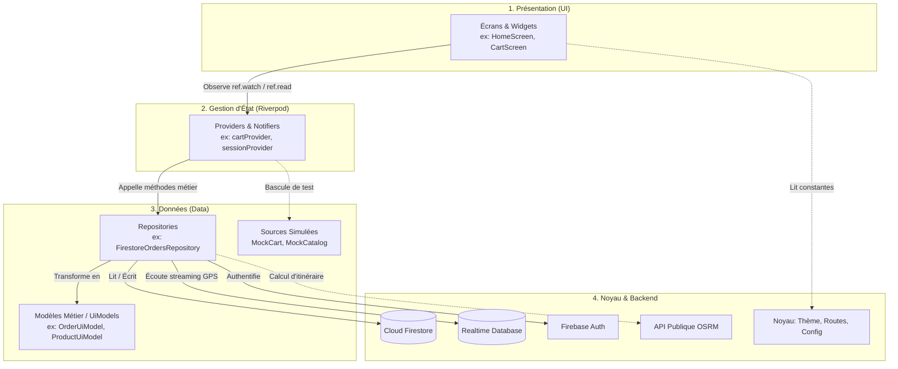

### Pourquoi séparer ainsi ?
1. **Indépendance de l'interface** : Un écran ne sait pas d'où viennent les données (base distante Firestore ou mémoire Mock). Il affiche uniquement ce que le Provider lui transmet.
2. **Testabilité unitaire** : On peut tester la logique d'un panier (`CartNotifier`) sans avoir besoin d'allumer un émulateur ou de se connecter à Internet.
3. **Immutabilité** : Les modèles (`UiModel`) sont en lecture seule. Pour modifier un état, on émet une nouvelle instance via `copyWith`, ce qui prévient les bugs d'effets de bord.

---

## 1.4 Fichiers et répertoires hors `lib/`

| Élément | Description et statut réel |
|---|---|
| `pubspec.yaml` | Fichier de configuration du projet définissant les dépendances Flutter (Firebase, Riverpod, GoRouter, FlutterMap, Geolocator, WorkManager) et les métadonnées de version. |
| `android/` | Projet natif Android hébergeant `google-services.json`, les permissions (GPS, notifications, Internet) et la configuration Gradle. |
| `test/` | Répertoire des tests unitaires et widgets (103 tests automatisés couvrant commandes, panier, profils, adresses, avis). |
| `firestore.rules` | Règles de sécurité officielles du projet Dokan déployées sur Firebase (contrôles stricts des rôles client, admin et livreur). |
| `firestore.indexes.json` | Définition des index composites Firestore nécessaires pour filtrer et trier les commandes et les avis. |
| `functions/` | Dossier Node.js contenant des Cloud Functions pour notifications. **Statut : Inactif en production client** (le projet fonctionne en mode 100% gratuit sans plan Blaze via `LocalOrderTrackerService`). |
| `firebase.json` | Configuration CLI reliant le projet local au projet cloud `ee-comeerce`. |

---

## 1.5 Mini-glossaire technique

- **Provider** : Objet Riverpod qui stocke et distribue une donnée ou un service dans toute l'application. Les widgets qui l'observent se redessinent automatiquement dès que sa valeur change.
- **Repository** : Classe passerelle qui s'occupe d'aller chercher ou d'enregistrer des données (dans Firestore, dans une API ou en mémoire). Il isole l'interface des détails techniques de la base.
- **Mock** : Fausse source de données locale utilisée en mémoire pour tester l'application ou l'utiliser sans connexion Internet.
- **UiModel** : Modèle de données simplifié et sécurisé conçu spécifiquement pour être affiché par l'écran (ex. `ProductUiModel`).
- **Stream** : Tuyau de données continu en temps réel. Dès qu'un document change dans Firebase, une nouvelle valeur arrive instantanément dans le Stream sans que l'utilisateur n'ait à recharger la page.
- **Router (GoRouter)** : Contrôleur qui gère les pages de l'application sous forme de chemins web (ex: `/product/123`), organise la pile de retour et protège les pages privées.

---

# Partie 2 — Flux Détaillés de Chaque Fonctionnalité

## 2.1 Démarrage et Splash Screen

1. **État** : ✅ Terminé
2. **But** : Initialiser le moteur Flutter, connecter Firebase et afficher le logo Dokan animé pendant 3 secondes avant de basculer vers l'accueil.
3. **Parcours utilisateur** :
   1. L'utilisateur clique sur l'icône de l'application Dokan sur son smartphone.
   2. Un écran vert épuré s'ouvre avec le logo Dokan qui apparaît en fondu avec un léger zoom (effet d'échelle 0.96 → 1.0).
   3. Pendant ce temps, Firebase Core s'initialise et la session utilisateur précédente est relue depuis Firebase Auth.
   4. Après 3 secondes exactes, la transition s'anime en fondu doux vers la page d'accueil (`/home`).
4. **Flux technique** :
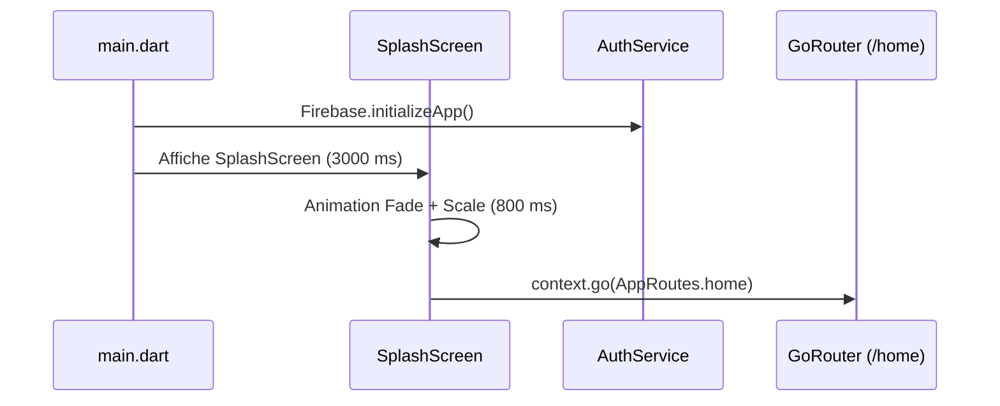
5. **Fichiers impliqués** :
   - `lib/main.dart` : Point d'entrée initialisant les liaisons.
   - `lib/feature/splash/splash_screen.dart` : Animation visuelle et timer de 3 secondes.
   - `lib/core/config/app_config.dart` : Définit la constante `splashDurationMs = 3000`.
   - `lib/core/navigation/app_router.dart` : Route initiale `/splash`.
6. **Données** : Lecture du cache local Firebase Auth (`currentUser`). Aucune écriture.
7. **Cas particuliers** : Si l'utilisateur n'a pas Internet, l'écran de démarrage fonctionne quand même et oriente vers l'accueil en mode déconnecté.
8. **Dépend des autres apps** : Aucune dépendance.
9. **Points fragiles** : Le délai de 3000 ms est fixe ; sur des téléphones très lents, l'initialisation de Firebase est masquée par ce délai, mais sur des téléphones récents, l'attente est purement esthétique.

---

## 2.2 Session et Authentification

1. **État** : ✅ Terminé
2. **But** : Permettre au visiteur de naviguer librement et au client de s'inscrire, se connecter ou récupérer son mot de passe sans jamais perdre son panier en cours.
3. **Parcours utilisateur** :
   1. Le visiteur explore les produits et ajoute des articles au panier sans être connecté.
   2. S'il clique sur « Favoris » ou « Commander », une boîte modale `AuthRequiredDialog` lui explique poliment qu'un compte est requis.
   3. Il clique sur « Se connecter » (ou « Créer un compte ») : l'écran de connexion s'ouvre.
   4. Il saisit ses identifiants et valide : Firebase Auth authentifie le compte et lit `users/{uid}`.
   5. Dès la connexion réussie, il est automatiquement redirigé vers l'action qu'il tentait de faire (ex: commande ou ajout aux favoris) sans avoir à recommencer.
4. **Flux technique** :
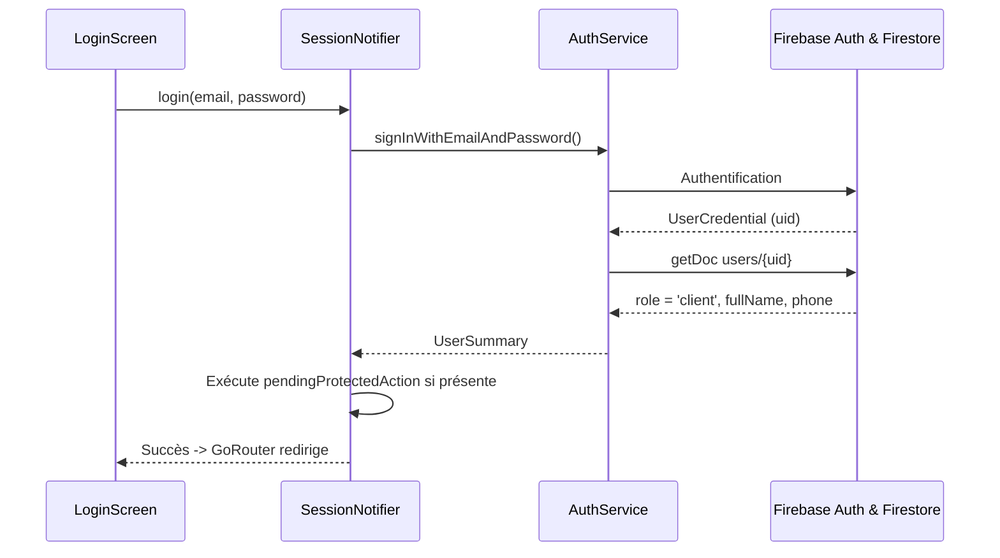
5. **Fichiers impliqués** :
   - `lib/core/session/session_provider.dart` : Gestionnaire d'état de session Riverpod.
   - `lib/services/auth_service.dart` : Appels à Firebase Auth et collection `users`.
   - `lib/feature/auth/login_screen.dart`, `register_screen.dart`, `forgot_password_screen.dart` : Formulaires d'authentification.
   - `lib/core/ui/auth_required_dialog.dart` : Dialogue d'invitation avec mémorisation d'action.
6. **Données** :
   - Écriture dans Firebase Auth (création compte) et `users/{uid}` (`email`, `fullName`, `phone`, `role: 'client'`, `createdAt`).
   - Le client n'a pas le droit d'écrire son propre rôle (règle Firestore).
7. **Cas particuliers** :
   - Mot de passe erroné ou compte inexistant : message d'erreur en français sous le formulaire.
   - Visiteur anonyme : session considérée valide en mode invité (`isGuest = true`).
8. **Dépend des autres apps** : L'app Admin peut modifier le rôle d'un utilisateur dans `users/{uid}`.
9. **Points fragiles** : La vérification d'e-mail par lien de confirmation n'est pas bloquante pour l'achat immédiat.

---

## 2.3 Catalogue, Recherche et Filtres

1. **État** : ✅ Terminé
2. **But** : Parcourir l'ensemble des articles par catégorie, effectuer des recherches textuelles rapides et appliquer des filtres combinés (prix, stock, tri).
3. **Parcours utilisateur** :
   1. Sur l'accueil ou l'onglet Catégories, l'utilisateur tape sur une rubrique (ex: Électroménager).
   2. Le catalogue s'ouvre avec la liste des produits correspondants.
   3. L'utilisateur peut taper sur « Filtrer » pour ajuster une tranche de prix ou cocher « En stock uniquement ».
   4. Il peut taper sur « Trier » pour classer par prix croissant, décroissant ou popularité.
   5. S'il utilise la barre de recherche, les résultats se mettent à jour avec mise en surbrillance.
4. **Flux technique** :
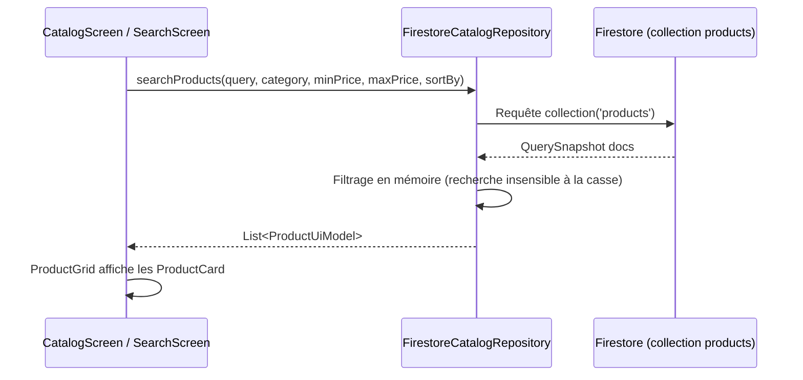
5. **Fichiers impliqués** :
   - `lib/feature/catalog/catalog_screen.dart` : Écran principal du catalogue.
   - `lib/feature/catalog/search_screen.dart` : Écran de recherche dédiée avec historique.
   - `lib/data/repositories/firestore_catalog_repository.dart` : Requêtes Firestore.
   - `lib/core/ui/filter_sheet.dart` & `sort_sheet.dart` : Feuilles de réglages des filtres.
   - `lib/core/ui/product_card.dart` & `product_grid.dart` : Rendu en grille 2 colonnes.
6. **Données** : Lecture seule de la collection `products`. Aucun document n'est modifié par le client.
7. **Cas particuliers** : Si aucun produit ne correspond, un état vide illustré (`EmptyState`) est affiché avec un bouton « Réinitialiser les filtres ».
8. **Dépend des autres apps** : Les produits sont ajoutés, renommés et réapprovisionnés par l'application **Admin**.
9. **Points fragiles** : Firestore ne supportant pas la recherche plein texte native (type Elasticsearch), la recherche textuelle effectue un filtrage local sur les noms de produits récupérés.

---

## 2.4 Fiche Produit Détaillée

1. **État** : ✅ Terminé
2. **But** : Consulter toutes les caractéristiques d'un produit (photos, prix officiel, promotions, poids, stock, description complète) et lire/déposer des avis clients.
3. **Parcours utilisateur** :
   1. L'utilisateur clique sur une carte produit depuis n'importe quel écran.
   2. La fiche produit s'ouvre avec la photo grand format, le prix mis en évidence et le badge promotionnel s'il y a lieu.
   3. Il peut ajuster la quantité souhaitée avec le sélecteur `[-] [1] [+]`.
   4. Il clique sur « Ajouter au panier » : une notification tactile s'active et le badge du panier s'incrémente.
   5. En faisant défiler vers le bas, il découvre la note moyenne, la répartition par étoiles et les avis rédigés par d'autres clients livrés.
4. **Flux technique** :
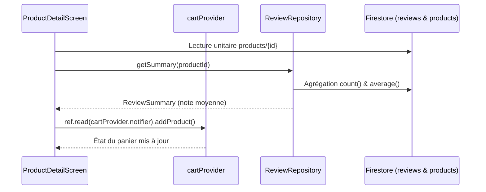
5. **Fichiers impliqués** :
   - `lib/feature/product/product_detail_screen.dart` : Structure de la page.
   - `lib/feature/product/widgets/product_reviews_section.dart` : Module des avis clients.
   - `lib/core/ui/quantity_selector.dart` : Contrôleur de quantité.
   - `lib/data/mock/mock_cart_repository.dart` : Réception de l'ajout panier.
6. **Données** : Lecture de `products/{productId}` et écoute de `reviews` (où `productId == ...`).
7. **Cas particuliers** : Produit épuisé (`inStock == false` ou `availability == 'outOfStock'`) : le bouton devient grisé et affiche « Produit en rupture ».
8. **Dépend des autres apps** : Les prix et stocks sont actualisés par l'Admin.
9. **Points fragiles** : Les photos proviennent d'URLs distantes ; une mauvaise connexion peut retarder l'affichage de l'image (une image de substitution est prévue).

---

## 2.5 Favoris

1. **État** : 🟡 Partiel (parfaitement fonctionnel en mémoire durant la session, mais non synchronisé dans le cloud Firestore de l'utilisateur)
2. **But** : Mettre de côté des produits coup de cœur en appuyant sur l'icône cœur pour les retrouver rapidement dans l'onglet dédié.
3. **Parcours utilisateur** :
   1. Sur une carte ou sur la fiche produit, l'utilisateur tape sur le cœur.
   2. Si c'est un visiteur, une boîte de dialogue l'invite à se connecter.
   3. Si le client est connecté, le cœur se remplit immédiatement de rouge (mise à jour optimiste sans latence).
   4. Dans l'onglet « Favoris », il retrouve tous ses articles sauvegardés avec possibilité de les basculer au panier en un clic.
4. **Flux technique** :
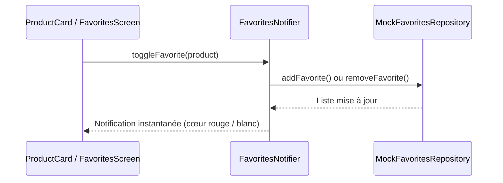
5. **Fichiers impliqués** :
   - `lib/feature/favorites/favorites_screen.dart` : Onglet dédié des favoris.
   - `lib/data/mock/mock_favorites_repository.dart` : Gestionnaire d'état en mémoire vive.
   - `lib/data/repositories/favorites_repository.dart` : Contrat d'interface.
6. **Données** : Stocké localement en mémoire dans l'instance de l'application pendant la session.
7. **Cas particuliers** : Si la liste est vide, affichage d'un écran vide incitant à explorer le catalogue avec un bouton de redirection.
8. **Dépend des autres apps** : Aucune dépendance.
9. **Points fragiles** : En cas de fermeture complète de l'application (tâche tuée), la liste des favoris revient aux articles de démonstration car la collection `users/{uid}/favorites` n'est pas encore connectée.

---

## 2.6 Panier et Ajout Rapide

1. **État** : 🟡 Partiel (calculs de prix, camion/voiture, code promo Firestore et suppression avec annulation Undo terminés à 100%, mais persistance hors-session en mémoire vive)
2. **But** : Rassembler les articles à commander, ajuster les quantités, appliquer un code promo et calculer automatiquement les frais de port et le véhicule requis.
3. **Parcours utilisateur** :
   1. L'utilisateur ajoute des articles depuis le bouton « + » d'une carte produit ou depuis la fiche produit.
   2. Le badge rouge sur l'icône panier s'incrémente instantanément.
   3. Dans l'onglet Panier, l'utilisateur visualise chaque article, son prix unitaire et son sous-total.
   4. Si le poids total dépasse 50 kg (ou un article > 30 kg), une bannière orange indique automatiquement : « 🚚 Camion officiel requis ».
   5. L'utilisateur peut saisir un code promo (ex: `PROMO10`) et cliquer sur « Appliquer » : le montant est recalculé.
   6. S'il supprime un article, une barre d'action SnackBar lui propose d'« Annuler » (Undo) pendant 4 secondes.
4. **Flux technique** :
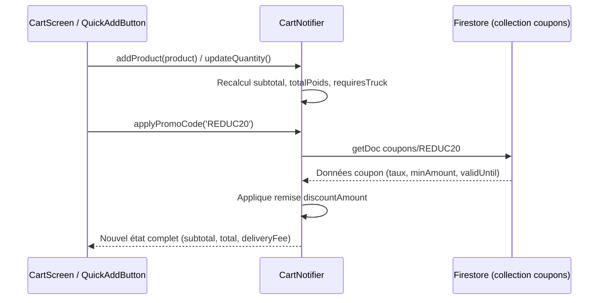
5. **Fichiers impliqués** :
   - `lib/feature/cart/cart_screen.dart` : Écran complet du panier.
   - `lib/data/mock/mock_cart_repository.dart` : Moteur de calcul du panier (`CartNotifier`).
   - `lib/core/ui/quick_add_button.dart` : Bouton compact d'ajout rapide sur les cartes.
   - `lib/core/ui/price_summary.dart` : Encadré récapitulatif des montants.
   - `lib/data/models/coupon_model.dart` : Validation des règles de codes promo.
6. **Données** : Lecture ponctuelle de `coupons/{code}` dans Firestore. Stockage du panier en mémoire d'application.
7. **Cas particuliers** :
   - Frais de port : 7 DT fixes, offerts (0 DT) dès 150 DT de commande.
   - Code promo expiré ou montant insuffisant : message d'erreur rouge clair sans bloquer le panier.
8. **Dépend des autres apps** : Les codes promotionnels sont créés dans Firestore par l'Admin.
9. **Points fragiles** : Le panier n'est pas encore sauvegardé dans un document Firestore `users/{uid}/cart` ; si l'utilisateur désinstalle l'app, le panier est vidé.

---

## 2.7 Adresses de Livraison

1. **État** : ✅ Terminé
2. **But** : Gérer les adresses de livraison du client avec sélection d'adresse par défaut, détection GPS de la position, pointage manuel sur carte OpenStreetMap et attribution automatique de la région logistique (`nord`, `centre`, `sud`).
3. **Parcours utilisateur** :
   1. Depuis le profil ou lors du checkout, l'utilisateur accède à « Mes adresses ».
   2. Il clique sur « Nouvelle adresse ».
   3. Il saisit le nom du destinataire, son numéro tunisien (8 chiffres), la rue et la ville.
   4. Il peut cliquer sur « Utiliser ma position actuelle » : le GPS du téléphone centre le marqueur sur la carte OSM intégrée.
   5. Il peut ajuster le marqueur en touchant directement la carte.
   6. Une pastille dynamique lui indique en direct : « 🚚 Région Dokan : SUD • Sfax » selon sa saisie.
   7. Il valide : l'adresse est enregistrée dans son compte Firestore.
4. **Flux technique** :
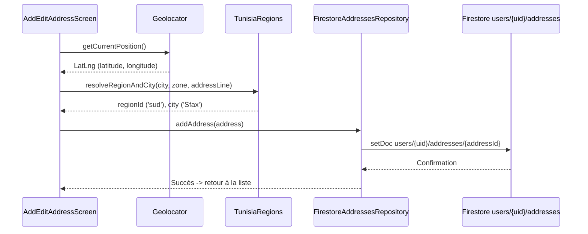
5. **Fichiers impliqués** :
   - `lib/feature/address/add_edit_address_screen.dart` : Formulaire avec carte `FlutterMap`.
   - `lib/feature/address/addresses_screen.dart` : Liste des adresses avec badge par défaut.
   - `lib/data/repositories/firestore_addresses_repository.dart` : Opérations Firestore sous `users/{uid}/addresses`.
   - `lib/core/utils/tunisia_regions.dart` : Résolution intelligente de région et ville.
6. **Données** : Écrit et lu dans `users/{uid}/addresses/{addressId}` (`addressLine`, `city`, `zone`, `latitude`, `longitude`, `isDefault`, `phone`).
7. **Cas particuliers** : Si la permission GPS est refusée, l'utilisateur peut pointer son domicile manuellement sur la carte sans être bloqué.
8. **Dépend des autres apps** : Le livreur lira ces coordonnées GPS exactes pour tracer son trajet vers le client.
9. **Points fragiles** : Si le client ne renseigne ni GPS ni ville reconnue, le système utilise un repli de secours sur le Grand Tunis (`nord`).

---

## 2.8 Commande (Checkout et Confirmation)

1. **État** : ✅ Terminé
2. **But** : Valider contractuellement la commande avec relecture sécurisée des prix dans Firestore, attribution atomique d'un identifiant lisible `DK-AAMMJJ-XXXX`, détection du véhicule requis et protection contre le double-clic.
3. **Parcours utilisateur** :
   1. Dans le panier, le client clique sur « Commander ».
   2. L'écran de récapitulatif s'ouvre, montrant les articles, l'adresse par défaut sélectionnée et le mode « Paiement en espèces à la livraison ».
   3. Le client peut changer d'adresse en un tap.
   4. Il clique sur « Confirmer la commande » : un indicateur de chargement bloque le bouton (anti-double-clic).
   5. L'application relit chaque article dans Firestore pour certifier les prix, crée la commande dans `orders/{orderId}`, vide le panier local et redirige vers l'écran de confirmation avec animation de succès.
4. **Flux technique** :
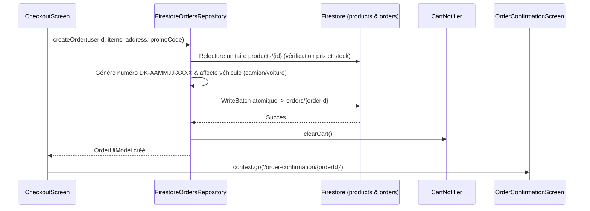
5. **Fichiers impliqués** :
   - `lib/feature/checkout/checkout_screen.dart` : Interface de révision contractuelle.
   - `lib/feature/checkout/order_confirmation_screen.dart` : Écran de succès avec numéro de commande.
   - `lib/data/repositories/firestore_orders_repository.dart` : Création transactionnelle de la commande.
   - `lib/data/models/order_model.dart` : Modèle de la commande et structure figée de l'adresse.
6. **Données** :
   - Création d'un document complet dans `orders/{orderId}`.
   - Champs officiels synchronisés : `status: 'en attente'`, `statut: 'en attente'`, `customerId`, `userId`, `customerName`, `customerPhone`, `deliveryAddress`, `items[]`, `total`, `createdAt`, `updatedAt`, `displayNumber`, `city`, `regionId`, `requiresTruck`, `requiredVehicleType`, `deliveryFee`.
7. **Cas particuliers** : Si un article est passé hors-stock entre l'ajout au panier et la validation, la commande est refusée et une alerte explicite informe le client.
8. **Dépend des autres apps** : Dès création, la commande apparaît instantanément sur le tableau de bord de l'application **Admin** et sur le radar des **Livreurs** de la région concernée.
9. **Points fragiles** : Seul le mode de paiement en espèces à la livraison (`cash_on_delivery`) est implémenté (aucun paiement par carte bancaire en ligne).

---

## 2.9 Mes Commandes et Détail

1. **État** : ✅ Terminé
2. **But** : Permettre au client de consulter l'historique complet de ses commandes, de suivre l'avancement étape par étape, d'annuler une commande encore en attente ou de recommander les mêmes articles.
3. **Parcours utilisateur** :
   1. Dans le profil, le client clique sur « Mes commandes ».
   2. La liste s'affiche avec des onglets de tri rapide (Toutes, En cours, Livrées, Annulées).
   3. Il clique sur une commande : la fiche détaillée s'ouvre avec l'adresse complète, la région logistique (`Région SUD • Sfax`), les articles et le récapitulatif financier.
   4. Une ligne du temps visuelle (Timeline) indique le statut officiel (`"en attente" → "en cours" → "enleve" → "livre"` ou `"annule"` / `"echec"`).
   5. Si le statut est `en attente`, un bouton rouge permet d'annuler la commande avec confirmation.
   6. Dès que le statut passe à `enleve` (colis scanné au dépôt), un bouton vert invite à « 🛵 Suivre mon livreur sur la carte ».
   7. Si la commande est `livre` (remise en main propre), des boutons « Donner mon avis » apparaissent en regard de chaque article.
4. **Flux technique** :
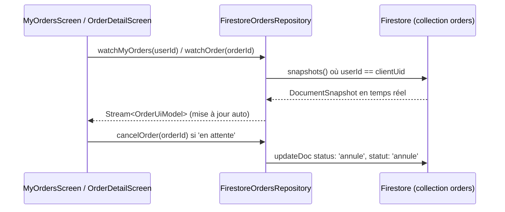
5. **Fichiers impliqués** :
   - `lib/feature/orders/my_orders_screen.dart` : Liste avec filtres par statut (`En attente`, `En cours`, `Enlevées`, `Livrées`, `Annulées`).
   - `lib/feature/orders/order_detail_screen.dart` : Fiche détaillée de la commande.
   - `lib/data/repositories/firestore_orders_repository.dart` : Flux temps réel `snapshots()` et annulation atomique en transaction.
   - `lib/data/models/order_status.dart` : Définition des 6 statuts officiels (`en attente`, `en cours`, `enleve`, `livre`, `annule`, `echec`) et leurs libellés français.
6. **Données** : Écoute en continu de `orders/{orderId}`. Mise à jour de `status: 'annule'` et `statut: 'annule'` en cas d'annulation par le client.
7. **Cas particuliers** : Dès que la commande passe à `en cours` (admin a accepté et livreur assigné), l'annulation par le client est automatiquement masquée et désactivée (seul l'Admin peut alors intervenir).
8. **Dépend des autres apps** : Le statut passe à `en cours` via l'**Admin** (livreur auto-assigné), puis à `enleve` (scan QR Code) et `livre` (remise en main propre) via le **Livreur**.
9. **Points fragiles** : L'historique dépend de la bonne écriture du tableau `statusHistory` par les applications Admin et Livreur.

---

## 2.10 Suivi des Statuts et Notifications Locales

1. **État** : ✅ Terminé (Architecture 100% gratuite et autonome)
2. **But** : Alerter le client par notification push locale dès que sa commande change d'état (ex: confirmée, en cours de livraison, livrée) sans abonnement serveur payant Cloud Functions.
3. **Parcours utilisateur** :
   1. Au premier passage de commande, une boîte de dialogue conviviale sollicite l'autorisation d'envoyer des notifications (Android 13+).
   2. Lorsque l'application est ouverte ou en pause, un écouteur Firestore surveille en direct les commandes actives.
   3. Dès que le livreur passe la commande à `out_for_delivery`, le téléphone émet un son, vibre et affiche la notification : « 🚚 Votre commande Dokan est en route ! ».
   4. Si l'application est totalement fermée (Terminated), une tâche planifiée WorkManager se réveille périodiquement pour vérifier les changements dans Firestore et émettre la notification locale.
   5. Un tap sur la notification ouvre directement le suivi de la commande concernée.
4. **Flux technique** :
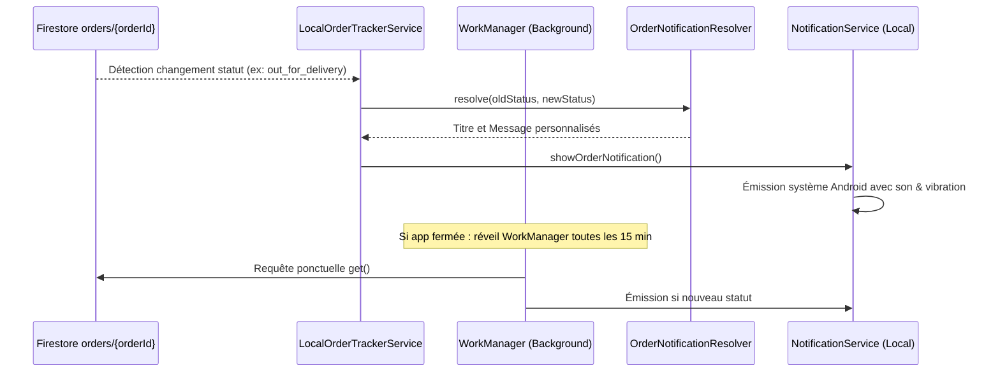
5. **Fichiers impliqués** :
   - `lib/services/local_order_tracker_service.dart` : Orchestrateur du suivi temps réel et tâche WorkManager.
   - `lib/services/notification_service.dart` : Gestionnaire natif `flutter_local_notifications`.
   - `lib/feature/orders/order_notification_resolver.dart` : Textes et emojis associés à chaque transition d'état.
   - `lib/feature/orders/notification_permission_dialog.dart` : Dialogue d'explication d'autorisation.
6. **Données** : Lecture de `orders` où `userId == clientUid` et comparaison avec le dernier statut mémorisé dans les `SharedPreferences` du téléphone.
7. **Cas particuliers** : Mode sans réseau : la notification est mise en attente et émise dès reconnexion.
8. **Dépend des autres apps** : Le déclenchement de la notification dépend du moment précis où l'Admin ou le Livreur valide l'étape suivante sur son téléphone.
9. **Points fragiles** : Sur certains téléphones Android avec économiseur de batterie agressif (Xiaomi, Huawei), la tâche WorkManager d'arrière-plan peut être retardée par le système d'exploitation si l'app est fermée depuis longtemps.

---

## 2.11 Suivi du Livreur sur la Carte (GPS & OSRM)

1. **État** : ✅ Terminé
2. **But** : Visualiser sur une carte interactive OpenStreetMap le véhicule officiel Dokan (🚗 voiture ou 🚚 camion) se déplaçant en direct vers le domicile du client avec tracé routier réel, calcul d'ETA et appel téléphonique direct.
3. **Parcours utilisateur** :
   1. Lorsque sa commande est au statut `out_for_delivery`, le client tape sur « Suivre mon livreur ».
   2. L'écran de tracking s'ouvre : la carte affiche la maison du client (marqueur vert) et le livreur (marqueur véhicule orienté selon sa direction réelle `heading`).
   3. Un tracé routier précis (ligne bleue) reliant le livreur au client s'affiche grâce au moteur OSRM.
   4. Un bandeau supérieur indique le véhicule officiel (`215 TU 8901`), le type (`Voiture officielle` ou `Camion officiel`) et un bouton vert pour appeler directement le livreur.
   5. En bas de l'écran, un compteur dynamique affiche la distance restante (ex: `1,2 km`) et l'heure d'arrivée estimée (ETA, ex: `14:35`).
   6. Dès que le livreur arrive à moins de 50 mètres, une alerte « Le livreur est arrivé à votre porte ! » retentit.
   7. Le livreur présente son écran affichant son QR Code unique sécurisé (`DOKAN-CONFIRM:{orderId}:{displayNumber}:{total}`).
   8. Le client tape sur le bouton bien visible « Confirmer la réception (Scanner QR Livreur) » (accessible depuis l'accueil, le suivi de commande ou la carte) :
      - Il scanne le QR Code avec la caméra (`mobile_scanner`).
      - En cas d'impossibilité de scanner, il peut saisir le **code PIN de secours à 6 chiffres** calculé selon `((orderId.hashCode.abs() % 900000) + 100000)`.
      - La commande bascule instantanément au statut officiel `livre` (`paymentStatus: 'paid'`), un dialogue de célébration s'ouvre pour noter le livreur (1 à 5 étoiles) et déposer un avis produit.
4. **Flux technique** :
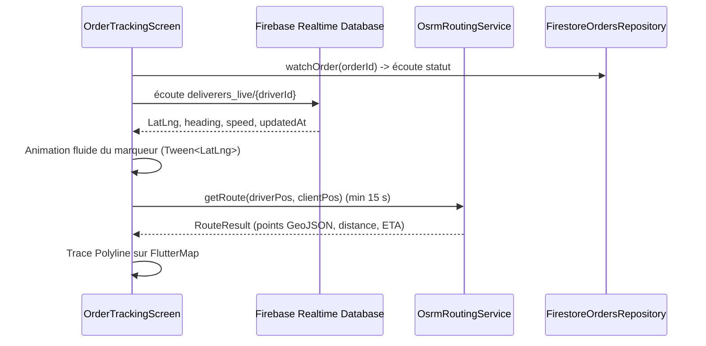
5. **Fichiers impliqués** :
   - `lib/feature/orders/order_tracking_screen.dart` : Écran complet de cartographie avec 8 états métier et bouton de scan QR réception.
   - `lib/feature/orders/qr_delivery_confirmation_screen.dart` : Scanner caméra QR Code (mobile_scanner) et boîte modale de saisie du PIN de secours.
   - `lib/feature/orders/widgets/active_delivery_banner.dart` : Bandeau intelligent d'accueil déclenchant le scan dès qu'une commande est en cours d'acheminement.
   - `lib/feature/orders/widgets/delivery_success_dialog.dart` : Dialogue festif avec notation 1-5 étoiles du livreur et passerelle vers les avis articles.
   - `lib/data/models/qr_confirmation_payload.dart` : Parser du protocole `DOKAN-CONFIRM` et algorithme de hachage du code PIN.
   - `lib/data/repositories/deliverer_location_repository.dart` : Écouteur RTDB sous `deliverers_live/{driverId}`.
   - `lib/services/osrm_routing_service.dart` : Calcul routier via API OSRM avec limitation de quota et repli vol d'oiseau.
   - `lib/data/models/deliverer_location.dart` : Structure de la position du livreur.
6. **Données** :
   - Lecture seule de Realtime Database : `deliverers_live/{driverId}` (`lat`, `lng`, `heading`, `updatedAt`).
   - Le client n'écrit jamais dans la Realtime Database.
7. **Cas particuliers** :
   - Livreur hors-ligne (> 2 minutes sans signal GPS) : affichage d'un badge ambré « Signal GPS momentanément perdu » sans faire planter la carte.
   - Commande terminée pendant le suivi : arrêt automatique des écoutes et affichage de l'animation de livraison réussie.
8. **Dépend des autres apps** : Le livreur doit avoir son application **Livreur Dokan** allumée avec son GPS activé pour émettre sa position dans `deliverers_live`.
9. **Points fragiles** : L'API OSRM publique impose un délai de 15 secondes minimum entre deux requêtes pour ne pas surcharger le serveur communautaire ; entre deux requêtes, la ligne est raccourcie localement sans réseau.

---

## 2.12 Avis Clients Post-Livraison

1. **État** : ✅ Terminé
2. **But** : Permettre au client de noter (1 à 5 étoiles) chaque produit reçu avec un commentaire facultatif, et afficher ces retours avec calcul de moyennes agrégées en temps réel sur la fiche produit.
3. **Parcours utilisateur** :
   1. Une fois sa commande livrée, le client ouvre le détail de la commande.
   2. Un bouton « Donner mon avis » apparaît sous chaque produit reçu.
   3. L'écran de notation s'ouvre avec un visage interactif expressif :
      - 1 étoile : visage déçu / mécontent (fond teinté rouge/orange).
      - 3 étoiles : visage neutre (fond ambré).
      - 5 étoiles : visage rayonnant avec clin d'œil / étoiles (fond vert Dokan).
   4. Il fait glisser le curseur haptique et peut saisir un commentaire (jusqu'à 500 caractères).
   5. Il valide : l'avis est enregistré dans Firestore avec l'identifiant déterministe `{orderId}_{productId}`.
   6. Immédiatement, sur la fiche du produit, la note moyenne est recalculée et son avis apparaît avec le badge « Votre avis » (avec options Modifier / Supprimer).
4. **Flux technique** :
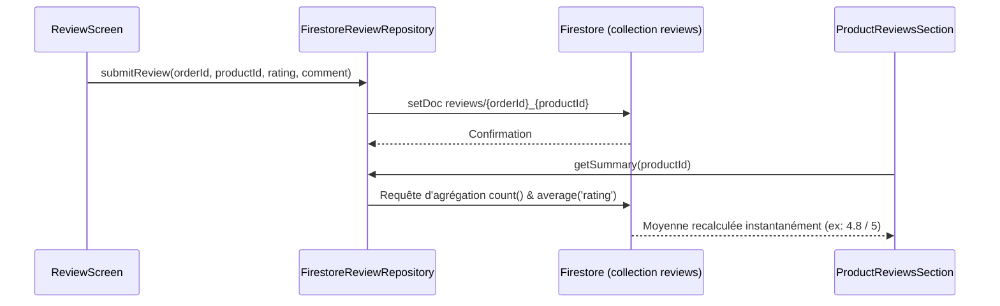
5. **Fichiers impliqués** :
   - `lib/feature/orders/review_screen.dart` : Écran interactif avec visage expressif animé.
   - `lib/feature/product/widgets/product_reviews_section.dart` : Section d'affichage des avis sur la fiche article.
   - `lib/data/repositories/review_repository.dart` : Repository Firestore et calcul d'agrégations gratuites.
   - `lib/data/models/review_model.dart` : Modèles `ReviewUiModel` et `ReviewSummary`.
6. **Données** :
   - Collection racine Firestore `reviews/{orderId}_{productId}`.
   - Champs : `productId`, `orderId`, `userId`, `authorName` (« Prénom I. », anonymisé pour respecter la vie privée), `rating` (1-5), `comment`, `createdAt`, `updatedAt`.
7. **Cas particuliers** :
   - Identifiant déterministe `{orderId}_{productId}` : empêche formellement tout doublon (un seul avis par produit et par commande livrée).
   - Un client ne peut pas noter un produit qu'il n'a pas commandé ou dont la commande n'est pas encore `delivered`.
8. **Dépend des autres apps** : L'app **Admin** peut consulter, masquer ou modérer les avis depuis son propre panneau d'administration.
9. **Points fragiles** : Si un client modifie son avis plusieurs fois, `updatedAt` est rafraîchi mais l'historique des anciennes notes n'est pas conservé (seule la version courante subsiste).

---

## 2.13 Profil, Paramètres, FAQ et Pages Légales

1. **État** : ✅ Terminé (sauf photo de profil : ⏳ initiales textuelles au lieu d'un téléversement d'image)
2. **But** : Gérer les données personnelles du client (nom, téléphone, mot de passe), consulter les questions fréquentes, lire les mentions légales et contacter le support d'assistance Dokan.
3. **Parcours utilisateur** :
   1. Dans l'onglet « Profil », le client voit son nom, son e-mail et ses raccourcis vers ses commandes et adresses.
   2. Il peut cliquer sur « Modifier le profil » pour changer son nom ou son numéro de téléphone.
   3. Il peut cliquer sur « Sécurité & Mot de passe » pour changer son code d'accès.
   4. Dans « Paramètres & Aide », il accède à la FAQ Dokan (8 questions avec accordéon strict : une seule réponse ouverte à la fois).
   5. Il peut consulter les « Conditions Générales » et la « Politique de Confidentialité » présentées sous forme de cartes synthétiques à cocher avec jauge de progression (ex: 6/6 points consultés).
   6. En cas de besoin, il tape sur « Contacter le support » : une modale lui propose d'appeler le `+216 71 000 000`, d'envoyer un e-mail ou d'ouvrir WhatsApp.
4. **Flux technique** :
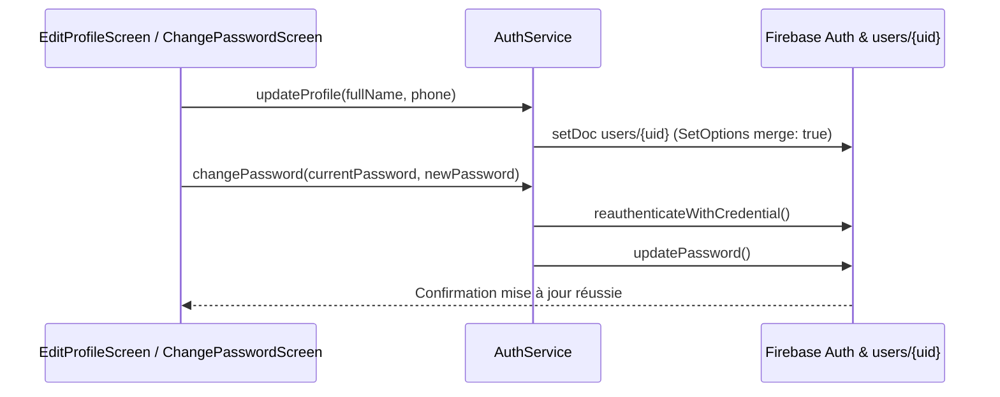
5. **Fichiers impliqués** :
   - `lib/feature/profile/profile_screen.dart` : Accueil du profil.
   - `lib/feature/profile/edit_profile_screen.dart` : Édition nom et téléphone.
   - `lib/feature/profile/change_password_screen.dart` : Sécurité et mot de passe.
   - `lib/feature/profile/faq_screen.dart` & `faq_data.dart` : Foire aux questions.
   - `lib/feature/profile/legal_screen.dart` & `key_points_data.dart` : Pages légales interactives.
   - `lib/feature/profile/support_bottom_sheet.dart` : Modale de contact direct.
6. **Données** : Écriture dans `users/{uid}` avec l'option `SetOptions(merge: true)` pour ne jamais écraser le champ `role`.
7. **Cas particuliers** : Protection `PopScope` sur l'écran d'édition de profil : si l'utilisateur a tapé du texte et tente de faire retour, un dialogue de confirmation lui demande s'il souhaite abandonner ses modifications.
8. **Dépend des autres apps** : Le support répond aux clients via les canaux indiqués (téléphone, e-mail).
9. **Points fragiles** : L'avatar du client affiche uniquement ses initiales générées automatiquement ; il n'y a pas de sélection d'image dans la galerie ni de stockage dans Firebase Storage.

---

## 2.14 Schéma de Bout en Bout : Du Panier à la Livraison

Le diagramme ci-dessous illustre l'intégralité du cycle de vie d'un achat sur Dokan, de l'exploration jusqu'au dépôt de l'avis final, en précisant **qui déclenche chaque changement de statut** :

```mermaid
flowchart TD
    A[Client : Ajoute des articles au panier] --> B[Client : Sélectionne son adresse de livraison]
    B --> C[Client : Confirme la commande au Checkout]
    C -->|Statut: pending<br/>Écrit par CLIENT| D[Commande créée dans orders/{id}]
    
    D --> E{Action Admin}
    E -->|Statut: confirmed<br/>Validé par ADMIN| F[Commande Confirmée]
    E -->|Statut: cancelled<br/>Par CLIENT ou ADMIN| Z[Commande Annulée]
    
    F -->|Statut: preparing<br/>Validé par ADMIN| G[Commande en Préparation à l'entrepôt]
    
    G --> H{Affectation Livreur}
    H -->|Statut: out_for_delivery<br/>Déclenché par LIVREUR| I[En cours de livraison]
    
    I -->|Position GPS en streaming<br/>dans deliverers_live/{id}| J[Client : Suivi en direct sur la carte]
    
    I -->|Statut: delivered<br/>Validé par LIVREUR à la porte| K[Commande Livrée]
    
    K --> L[Client : Notification de réception]
    L --> M[Client : Dépôt d'avis 1-5 étoiles sur ReviewScreen]
    M -->|reviews/{orderId}_{productId}| N[Mise à jour de la note moyenne sur la fiche produit]
```

---

# Partie 3 — Guide Visuel : Modifier Chaque Élément de l'Interface

Ce chapitre passe en revue **chaque écran de l'application**, présente son schéma visuel, référence chaque widget et fournit les recettes exactes pour modifier l'interface sans casser la logique.

---

## 3.1 Écran de Démarrage (`SplashScreen`)
- **Route** : `/splash` (`AppRoutes.splash`)
- **Fichier** : `lib/feature/splash/splash_screen.dart`
- **Arrivée** : Écran initial au lancement de l'application.

### Schéma visuel (ASCII)
```text
+------------------------------------------+
|                                          |
|                                          |
|                [ LOGO ]                  |
|                 DOKAN                    |
|          Boutique Tunisienne             |
|                                          |
|                 ( * )                    |
|         Chargement sécurisé...           |
|                                          |
+------------------------------------------+
```

### Éléments modifiables
| Élément visible | Widget et fichier | Données / État | Comment le modifier concrètement |
|---|---|---|---|
| Fond vert plein écran | `Scaffold.backgroundColor` dans `splash_screen.dart` | `AppColors.primary` | Modifier `primary` dans `lib/core/theme/app_colors.dart`. |
| Logo animé Dokan | `DokanLogo` dans `lib/core/ui/dokan_logo.dart` | Widget vectoriel statique | Modifier la taille `size` ou les proportions dans `dokan_logo.dart`. |
| Durée d'affichage (3s) | `AppConfig.splashDurationMs` | Constante `3000` | Changer la valeur dans `lib/core/config/app_config.dart`. |
| Texte de sous-titre | `Text` sous le logo dans `splash_screen.dart` | Chaîne fixe | Éditer la chaîne de caractères dans `splash_screen.dart`. |

### Recettes fréquentes
- **Changer la durée du splash** : Ouvrir `lib/core/config/app_config.dart` et modifier `static const int splashDurationMs = 2000;`.
- **Remplacer l'animation de transition** : Dans `lib/core/navigation/app_router.dart`, modifier le `FadeTransition` et `ScaleTransition` de la route `/splash`.

---

## 3.2 Écran d'Accueil (`HomeScreen`)
- **Route** : `/home` (`AppRoutes.home`)
- **Fichier** : `lib/feature/home/home_screen.dart`
- **Arrivée** : Onglet 1 de la barre inférieure `MainShell`.

### Schéma visuel (ASCII)
```text
+------------------------------------------+
| [Dokan Logo]                    [Panier (3)] | <- AppTopBar
| [ Q Rechercher un produit, une marque... ] | <- Barre de recherche
|------------------------------------------|
| [ BANNIÈRE CARROUSEL INTERACTIF  2/4 ]   | <- InteractiveBannerCarousel
|  ooo=o (Indicateurs animés à progression)|
|------------------------------------------|
| Catégories Populaires           [Voir tout] |
| (Électro) (Mode) (Maison) (High-Tech)... |
|------------------------------------------|
| Nouveaux Arrivages              [Voir tout] |
| [Carte Prod 1]  [Carte Prod 2]           |
|------------------------------------------|
| Meilleures Promotions 🔥       [Voir tout] |
| [Carte Promo 1] [Carte Promo 2]          |
|==========================================|
| [Accueil] [Catégories] [Favoris] [Panier] [Profil] | <- MainShell
+------------------------------------------+
```

### Éléments modifiables
| Élément visible | Widget et fichier | Données / État | Comment le modifier concrètement |
|---|---|---|---|
| Barre supérieure avec Logo | `AppTopBar` dans `home_screen.dart` | Titre ou logo Dokan | Modifier les paramètres de `AppTopBar` dans `home_screen.dart`. |
| Badge sur le panier | `Badge` dans `home_screen.dart` | `cartCountProvider` | Ajuster la couleur `AppColors.accent` ou le style du texte. |
| Champ de recherche factice | `Container` cliquable dans `home_screen.dart` | Ouvre `/search` au tap | Modifier le texte d'invite ou le rayon dans `home_screen.dart`. |
| Carrousel de bannières | `InteractiveBannerCarousel` dans `home/widgets/` | Liste statique de 4 bannières | Modifier les couleurs, titres et boutons dans `interactive_banner_carousel.dart`. |
| Boutons de catégories rondes | `ListView.builder` horizontal | `homeCategoriesProvider` | Modifier les icônes dans `firestore_catalog_repository.dart`. |
| Rayon Nouveaux Arrivages | `ListView` horizontal de `ProductCard` | `newProductsProvider` | Filtre `isNew == true` dans `product_service.dart`. |
| Rayon Promotions | `ListView` horizontal de `ProductCard` | `discountedProductsProvider` | Filtre `hasDiscount` dans `product_service.dart`. |

### Recettes fréquentes
- **Changer la vitesse de défilement du carrousel** : Dans `interactive_banner_carousel.dart`, modifier `Duration(seconds: 4)` par la durée voulue.
- **Ajouter un rayon supplémentaire (ex: Produits Populaires)** : Dupliquer un bloc `_buildProductSection` dans `home_screen.dart` en le reliant à `popularProductsProvider`.

---

## 3.3 Écran des Catégories (`CategoriesScreen`)
- **Route** : `/categories` (`AppRoutes.categories`)
- **Fichier** : `lib/feature/catalog/categories_screen.dart`
- **Arrivée** : Onglet 2 de la barre inférieure.

### Schéma visuel (ASCII)
```text
+------------------------------------------+
| Catégories                       [Panier] |
+------------------------------------------+
| [Icon] Électroménager           (24 art) > |
| [Icon] Vêtements & Mode         (18 art) > |
| [Icon] Chaussures               (12 art) > |
| [Icon] Smartphones & Tablettes  (15 art) > |
| [Icon] Maison & Cuisine         (30 art) > |
| [Icon] Beauté & Soins           (10 art) > |
+------------------------------------------+
```

### Éléments modifiables
| Élément visible | Widget et fichier | Données / État | Comment le modifier concrètement |
|---|---|---|---|
| Liste des tuiles de catégorie | `ListTile` dans `categories_screen.dart` | `categoriesProvider` | Modifier le design des cartes dans `categories_screen.dart`. |
| Icône de chaque catégorie | `Icon(cat.icon)` | `CategoryUiModel.icon` | Changer le mapping icône/nom dans `firestore_catalog_repository.dart`. |
| Nombre d'articles affiché | `Text('${cat.productCount} articles')` | Calcul dynamique | Ajuster la chaîne de texte dans `categories_screen.dart`. |

---

## 3.4 Écran du Catalogue (`CatalogScreen`)
- **Route** : `/catalog` (`AppRoutes.catalog`)
- **Fichier** : `lib/feature/catalog/catalog_screen.dart`
- **Arrivée** : Clic sur « Voir tout » depuis l'accueil ou clic sur une catégorie.

### Schéma visuel (ASCII)
```text
+------------------------------------------+
| [<] Électroménager                       |
|------------------------------------------|
| 14 articles       [Trier v]  [Filtrer o] | <- Barre d'outils
|------------------------------------------|
| [Carte Produit 1]    [Carte Produit 2]   |
| 120,000 DT           45,000 DT           |
|                                          |
| [Carte Produit 3]    [Carte Produit 4]   |
| 89,000 DT            199,000 DT          |
+------------------------------------------+
```

### Éléments modifiables
| Élément visible | Widget et fichier | Données / État | Comment le modifier concrètement |
|---|---|---|---|
| Bouton Trier | `OutlinedButton.icon` | `SortSheet` | Modifier les options de tri dans `lib/core/ui/sort_sheet.dart`. |
| Bouton Filtrer | `OutlinedButton.icon` | `FilterSheet` | Modifier les tranches de prix dans `lib/core/ui/filter_sheet.dart`. |
| Grille des produits | `ProductGrid` dans `lib/core/ui/` | `_products` | Modifier le ratio d'aspect des cartes dans `product_grid.dart`. |

---

## 3.5 Écran de Recherche (`SearchScreen`)
- **Route** : `/search` (`AppRoutes.search`)
- **Fichier** : `lib/feature/catalog/search_screen.dart`
- **Arrivée** : Tap sur la fausse barre de recherche de l'accueil.

### Schéma visuel (ASCII)
```text
+------------------------------------------+
| [<] [ Entrez votre recherche...    (X) ] |
|------------------------------------------|
| Recherches récentes              [Effacer]|
| ( Cafetière )  ( Samsung A55 ) ( Baskets ) |
|------------------------------------------|
| Suggestions populaires                   |
| > Robe d'été                             |
| > Réfrigérateur                          |
| > Écouteurs sans fil                     |
+------------------------------------------+
```

### Éléments modifiables
| Élément visible | Widget et fichier | Données / État | Comment le modifier concrètement |
|---|---|---|---|
| Champ de saisie actif | `TextField` dans `search_screen.dart` | `_searchController` | Ajuster le `hintText` ou les bordures dans `search_screen.dart`. |
| Puces de recherches récentes | `ActionChip` dans `search_screen.dart` | `SharedPreferences` | Modifier le style des puces dans `search_screen.dart`. |
| Liste des suggestions | `ListTile` avec icône loupe | Liste statique/dynamique | Personnaliser les suggestions dans `search_screen.dart`. |

---

## 3.6 Fiche Produit (`ProductDetailScreen`)
- **Route** : `/product/:id` (`AppRoutes.productDetail`)
- **Fichier** : `lib/feature/product/product_detail_screen.dart`
- **Arrivée** : Tap sur n'importe quel produit dans l'application.

### Schéma visuel (ASCII)
```text
+------------------------------------------+
| [<]                               [Coeur]|
|------------------------------------------|
|               [ GRAND FORMAT ]           |
|                IMAGE PRODUIT             |
|                                          |
|------------------------------------------|
| Titre du Produit                         |
| 129,000 DT  150,000 DT  [PROMO -14%]     |
| Poids : 2.5 kg | En stock                |
|------------------------------------------|
| Quantité :             [-]  [ 1 ]  [+]   |
|------------------------------------------|
| Description du produit                   |
| Détails techniques, caractéristiques...  |
|------------------------------------------|
| Avis des clients (⭐ 4.8 / 5 - 12 avis)  |
| [=====] 5 étoiles (10)                   |
| [=    ] 4 étoiles (2)                    |
| [ Carte Avis 1 : "Super qualité !" ]     |
|------------------------------------------|
| [ Coeur ]   [ 🛒 Ajouter au panier ]      | <- Barre fixe inférieure
+------------------------------------------+
```

### Éléments modifiables
| Élément visible | Widget et fichier | Données / État | Comment le modifier concrètement |
|---|---|---|---|
| Image principale | `Image.network` avec placeholder | `product.imageUrl` | Ajuster la hauteur (320) dans `product_detail_screen.dart`. |
| Prix et réduction | `Row` avec textes barrés et badge | `product.price`, `product.oldPrice` | Modifier le style dans `product_detail_screen.dart`. |
| Sélecteur de quantité | `QuantitySelector` dans `lib/core/ui/` | État local `_quantity` | Modifier la taille des boutons dans `quantity_selector.dart`. |
| Bloc des avis clients | `ProductReviewsSection` dans `product/widgets/` | `productReviewSummaryProvider` | Modifier l'apparence des étoiles dans `product_reviews_section.dart`. |
| Bouton fixe d'ajout | `ElevatedButton` dans barre inférieure | `cartProvider` | Modifier la couleur ou l'icône du panier dans `product_detail_screen.dart`. |

---

## 3.7 Écran des Favoris (`FavoritesScreen`)
- **Route** : `/favorites` (`AppRoutes.favorites`)
- **Fichier** : `lib/feature/favorites/favorites_screen.dart`
- **Arrivée** : Onglet 3 de la barre inférieure.

### Schéma visuel (ASCII)
```text
+------------------------------------------+
| Mes Favoris                     [Effacer]|
+------------------------------------------+
| [Carte Favori 1]      [Carte Favori 2]   |
| (x) Retirer           (x) Retirer        |
| 59,000 DT             120,000 DT         |
| [Ajouter au panier]   [Ajouter au panier]|
+------------------------------------------+
```

### Éléments modifiables
| Élément visible | Widget et fichier | Données / État | Comment le modifier concrètement |
|---|---|---|---|
| Grille des favoris | `ProductGrid` dans `favorites_screen.dart` | `favoritesProvider` | Modifier le message d'état vide dans `favorites_screen.dart`. |
| Écran d'invitation visiteur | `EmptyState` avec bouton connexion | `session.isGuest` | Modifier le texte d'invitation dans `favorites_screen.dart`. |

---

## 3.8 Écran du Panier (`CartScreen`)
- **Route** : `/cart` (`AppRoutes.cart`)
- **Fichier** : `lib/feature/cart/cart_screen.dart`
- **Arrivée** : Onglet 4 de la barre inférieure ou icône panier de la barre supérieure.

### Schéma visuel (ASCII)
```text
+------------------------------------------+
| Mon Panier (2 articles)         [Vider]  |
+------------------------------------------+
| [🚚 Camion requis : Poids lourd > 50 kg] | <- Bannière dynamique véhicule
|------------------------------------------|
| [Image] Cafetière Expresso      89,000 DT|
|         Quantité: [-] [1] [+]     [Poub] |
|------------------------------------------|
| [Image] Set de Casseroles      129,000 DT|
|         Quantité: [-] [2] [+]     [Poub] |
|------------------------------------------|
| Code promo : [ DOKAN10   ] [Appliquer]   |
|------------------------------------------|
| Sous-total :                  347,000 DT |
| Frais de livraison :             Gratuit |
| Remise promo :                -34,700 DT |
| Total TTC :                   312,300 DT |
|------------------------------------------|
| [       Passer la commande (312 DT)    ] | <- Bouton fixe Commander
+------------------------------------------+
```

### Éléments modifiables
| Élément visible | Widget et fichier | Données / État | Comment le modifier concrètement |
|---|---|---|---|
| Bannière Camion / Voiture | `_buildVehicleBanner()` dans `cart_screen.dart` | `cartState.requiresTruck` | Modifier les seuils de poids (50 kg / 30 kg) dans `mock_cart_repository.dart`. |
| Ligne d'article du panier | `_buildCartItemCard()` dans `cart_screen.dart` | `CartItemUiModel` | Modifier les espacements et boutons dans `cart_screen.dart`. |
| Champ de code promo | `_buildPromoSection()` dans `cart_screen.dart` | `applyPromoCode()` | Modifier le style du champ dans `cart_screen.dart`. |
| Récapitulatif financier | `PriceSummary` dans `lib/core/ui/` | Totaux calculés | Modifier les libellés dans `lib/core/ui/price_summary.dart`. |
| Bouton Commander | `_buildBottomCheckoutBar()` | `context.push(AppRoutes.checkout)` | Modifier la hauteur et la couleur dans `cart_screen.dart`. |

---

## 3.9 Écran de Commande (`CheckoutScreen`)
- **Route** : `/checkout` (`AppRoutes.checkout`)
- **Fichier** : `lib/feature/checkout/checkout_screen.dart`
- **Arrivée** : Clic sur « Passer la commande » depuis le panier.

### Schéma visuel (ASCII)
```text
+------------------------------------------+
| [<] Validation de la commande            |
+------------------------------------------+
| 📍 Adresse de livraison       [Changer]  |
| Mohamed Ben Salah (+216 21 000 000)      |
| 15 Rue de la Liberté, SUD, Sfax          |
|------------------------------------------|
| 🚚 Mode de livraison                     |
| (*) Livraison Standard Dokan (48-72h)    |
|------------------------------------------|
| 💵 Mode de paiement                      |
| (*) Paiement en espèces à la livraison   |
|------------------------------------------|
| Articles commandés (2)                   |
| • Cafetière Expresso (x1)      89,000 DT |
| • Set Casseroles (x2)         258,000 DT |
|------------------------------------------|
| Total TTC :                   347,000 DT |
|------------------------------------------|
| [   Confirmer la commande (347,000 DT) ] | <- Bouton anti-double-clic
+------------------------------------------+
```

### Éléments modifiables
| Élément visible | Widget et fichier | Données / État | Comment le modifier concrètement |
|---|---|---|---|
| Carte de l'adresse sélectionnée | `_buildAddressCard()` | `addressesStreamProvider` | Modifier l'agencement dans `checkout_screen.dart`. |
| Mode de livraison | `_buildDeliveryMethodCard()` | Texte fixe | Modifier le texte explicatif dans `checkout_screen.dart`. |
| Bouton de confirmation | `ElevatedButton` dans barre inférieure | `createOrder()` | Modifier le texte ou la couleur du bouton dans `checkout_screen.dart`. |

---

## 3.10 Confirmation de Commande (`OrderConfirmationScreen`)
- **Route** : `/order-confirmation/:id` (`AppRoutes.orderConfirmation`)
- **Fichier** : `lib/feature/checkout/order_confirmation_screen.dart`
- **Arrivée** : Redirection automatique après succès de `createOrder()`.

### Schéma visuel (ASCII)
```text
+------------------------------------------+
|                                          |
|                (  ✓  )                   | <- Cercle vert animé
|        Commande Confirmée !              |
|                                          |
| Numéro de commande :                     |
| [         DK-261108-A4F9               ] | <- Pastille copiable
|                                          |
| Nous préparons vos articles avec soin.   |
| Vous recevrez une alerte lors de l'envoi.|
|                                          |
| [         Suivre ma commande           ] |
| [         Retour à l'accueil           ] |
+------------------------------------------+
```

### Éléments modifiables
| Élément visible | Widget et fichier | Données / État | Comment le modifier concrètement |
|---|---|---|---|
| Icône de coche verte | `Icon(Icons.check_circle_rounded)` | Couleur `AppColors.success` | Modifier la taille (80) dans `order_confirmation_screen.dart`. |
| Pastille numéro de commande | `Container` avec icône copie | `order.displayNumber` | Modifier la police à chasse fixe dans `order_confirmation_screen.dart`. |
| Boutons d'action | `ElevatedButton` & `OutlinedButton` | Redirections GoRouter | Modifier les libellés dans `order_confirmation_screen.dart`. |

---

## 3.11 Liste des Commandes (`MyOrdersScreen`)
- **Route** : `/orders` (`AppRoutes.myOrders`)
- **Fichier** : `lib/feature/orders/my_orders_screen.dart`
- **Arrivée** : Depuis le profil (« Mes commandes »).

### Schéma visuel (ASCII)
```text
+------------------------------------------+
| [<] Mes commandes                        |
+------------------------------------------+
| [ Toutes ]  [ En cours ]  [ Livrées ]    | <- Filtres horizontaux
|------------------------------------------|
| [Carte Commande DK-261108-A4F9]          |
| Statut : [ En cours de livraison ] 🚚   |
| 2 articles • Total : 129,000 DT          |
| 08 Nov 2026 à 14:20                      |
| [ Suivre le livreur ]   [ Détails > ]    |
+------------------------------------------+
```

---

## 3.12 Détail d'une Commande (`OrderDetailScreen`)
- **Route** : `/orders/:id` (`AppRoutes.orderDetail`)
- **Fichier** : `lib/feature/orders/order_detail_screen.dart`
- **Arrivée** : Clic sur une commande depuis `MyOrdersScreen`.

### Schéma visuel (ASCII)
```text
+------------------------------------------+
| [<] Commande DK-261108-A4F9              |
+------------------------------------------+
| Livreur assigné : Obayd (Voiture) [Appel]| <- Si assigné
|------------------------------------------|
| [o]---[o]---[o]---(o)---[ ]              | <- Timeline de statut
| Validée > Préparée > En route > Livrée   |
|------------------------------------------|
| 📍 Adresse de livraison                  |
| [ Région SUD • Sfax ]                    | <- Badge logistique
| Mohamed Ben Salah                        |
| Rue Habib Bourguiba, Sfax, Tunisie       |
|------------------------------------------|
| Articles commandés (1)                   |
| [Image] Set de Casseroles    129,000 DT  |
|         [ ⭐ Donner mon avis ]           | <- Si delivered
|------------------------------------------|
| [ Bouton Annuler ] ou [ Suivre Livreur ] |
+------------------------------------------+
```

---

## 3.13 Suivi GPS du Livreur (`OrderTrackingScreen`)
- **Route** : `/orders/:id/tracking` (`AppRoutes.orderTracking`)
- **Fichier** : `lib/feature/orders/order_tracking_screen.dart`
- **Arrivée** : Bouton « Suivre le livreur sur la carte ».

### Schéma visuel (ASCII)
```text
+------------------------------------------+
| [<] Suivi de livraison                   |
+------------------------------------------+
| [🚗 Voiture officielle Dokan - 215 TU 8901] |
| Livreur : Obayd                 [📞 Appel] |
|------------------------------------------|
|                                          |
|      (🏠 Domicile Client)                |
|           \                              |
|            \                             |
|             ====== (Ligne itinéraire OSRM)|
|                   \                      |
|                 (🚗 Livreur orienté)     |
|                                          |
| [Centrer sur le livreur]                 |
|------------------------------------------|
| Distance : 1,4 km  •  Arrivée vers 14:35 |
| Statut : Le livreur approche de chez vous|
+------------------------------------------+
```

---

## 3.14 Écran d'Avis Produit (`ReviewScreen`)
- **Route** : `/orders/:orderId/review/:productId` (`AppRoutes.orderReview`)
- **Fichier** : `lib/feature/orders/review_screen.dart`
- **Arrivée** : Clic sur « Donner mon avis » depuis `OrderDetailScreen`.

### Schéma visuel (ASCII)
```text
+------------------------------------------+
| [<] Donner mon avis                      |
+------------------------------------------+
| Article : Set de Casseroles              |
|                                          |
|               (  ^ ‿ ^  )                | <- Visage animé interactif
|            "Très satisfait !"            |
|                                          |
|           ⭐   ⭐   ⭐   ⭐   ⭐           |
|       ( Curseur interactif haptique )    |
|                                          |
| Partagez votre expérience (facultatif)   |
| [ Produit robuste et conforme !      ]   |
|                               (42 / 500) |
|                                          |
| [          Publier mon avis            ] |
+------------------------------------------+
```

---

## 3.15 Adresses de Livraison (`AddressesScreen` & `AddEditAddressScreen`)
- **Routes** : `/addresses`, `/addresses/add`, `/addresses/edit/:id`
- **Fichiers** : `lib/feature/address/addresses_screen.dart` et `add_edit_address_screen.dart`
- **Arrivée** : Depuis le profil ou le checkout.

### Schéma visuel de saisie d'adresse
```text
+------------------------------------------+
| [<] Nouvelle adresse                     |
+------------------------------------------+
| Nom complet du destinataire *            |
| [ Mohamed Ben Salah                    ] |
| Numéro de téléphone (8 chiffres) *       |
| [ 21 000 000                           ] |
| Adresse (Rue, Bâtiment) *                |
| [ Rue Habib Bourguiba, Sfax            ] |
| Ville *                  Région/Quartier |
| [ Sfax                ]  [ SUD         ] |
| [🚚 Région Dokan : SUD • Sfax          ] | <- Détection en direct
|                                          |
| Position sur la carte (facultatif)       |
| [ 🎯 Utiliser ma position GPS actuelle ] |
| +--------------------------------------+ |
| | [CARTE OSM]      (📍 Mon domicile)   | |
| +--------------------------------------+ |
| [X] Définir comme adresse par défaut     |
| [        Enregistrer l'adresse         ] |
+------------------------------------------+
```

---

## 3.16 Authentification (`LoginScreen`, `RegisterScreen`, `ForgotPasswordScreen`)
- **Routes** : `/login`, `/register`, `/forgot-password`
- **Fichiers** : `lib/feature/auth/login_screen.dart`, `register_screen.dart`, `forgot_password_screen.dart`

### Schéma visuel Connexion
```text
+------------------------------------------+
| [<] Connexion à Dokan                    |
+------------------------------------------+
|            [ LOGO DOKAN ]                |
|                                          |
| Adresse e-mail                           |
| [ exemple@domaine.tn                   ] |
| Mot de passe                             |
| [ ••••••••••••                     (👁) ] |
|               [Mot de passe oublié ?]    |
|                                          |
| [             Se connecter             ] |
|                                          |
| Pas encore de compte ? [Créer un compte] |
+------------------------------------------+
```

---

## 3.17 Profil Utilisateur (`ProfileScreen`, `EditProfileScreen`, `ChangePasswordScreen`)
- **Routes** : `/profile`, `/profile/edit`, `/profile/change-password`
- **Fichiers** : `lib/feature/profile/profile_screen.dart`, `edit_profile_screen.dart`, `change_password_screen.dart`

### Schéma visuel Profil Client
```text
+------------------------------------------+
| Mon Profil                               |
+------------------------------------------+
|      ( MB )  Mohamed Ben Salah           |
|              mohamed@gmail.com           |
|              Tél : +216 21 000 000       |
|                                          |
| [ 📦 Mes commandes ]                  >  |
| [ 📍 Mes adresses de livraison ]      >  |
| [ 👤 Modifier mes informations ]      >  |
| [ 🔒 Sécurité & Mot de passe ]        >  |
| [ ⚙️ Paramètres & Aide ]              >  |
|                                          |
| [ 🚪 Se déconnecter ] (Bouton rouge)     |
+------------------------------------------+
```

---

## 3.18 Paramètres, FAQ et Légal (`SettingsAndHelpScreen`, `FaqScreen`, `LegalScreen`)
- **Routes** : `/settings`, `/help/faq`, `/legal/terms`, `/legal/privacy`
- **Fichiers** : `lib/feature/profile/settings_and_help_screen.dart`, `faq_screen.dart`, `legal_screen.dart`

---

## 3.19 Système de Thème et Constantes Visuelles

Toutes les couleurs, dimensions et styles de l'application sont centralisés dans `lib/core/theme/`. **Aucune couleur n'est écrite en dur dans les écrans.**

### Palette de Couleurs (`app_colors.dart`)
- `AppColors.primary` : Vert Dokan `#00695C` (Teal profond, barre d'onglets active, boutons principaux).
- `AppColors.primaryDark` : `#004D40` (survol et ombres).
- `AppColors.primaryLight` : `#80CBC4` (surbrillances légères).
- `AppColors.primarySoft` : `#E0F2F1` (fonds de pastilles et badges doux).
- `AppColors.accent` : Orange `#E65100` (promotions, badges nouveautés, compteur du panier).
- `AppColors.background` : Blanc cassé `#F8F9FA` (fond général de tous les écrans).
- `AppColors.surface` : Blanc pur `#FFFFFF` (cartes, formulaires, barres de dialogue).
- `AppColors.textPrimary` : Gris très foncé `#1A1A1A` (titres et textes principaux).
- `AppColors.textSecondary` : Gris moyen `#666666` (sous-titres, dates, légendes).
- `AppColors.error` : Rouge `#D32F2F` (alertes, bouton déconnexion, annulation).
- `AppColors.success` : Vert franc `#2E7D32` (succès de commande, statut livré).

### Échelle de Dimensions (`app_dimens.dart`)
- Espacements : `space4` (4), `space8` (8), `space12` (12), `space16` (16), `space24` (24), `space32` (32).
- Rayons d'arrondi : `radius4` (4), `radius8` (8), `radius12` (12), `radius16` (16), `radius24` (24).
- Tailles d'icônes : `iconSmall` (16), `iconMedium` (24), `iconLarge` (32).

---

## 3.20 Composants UI Réutilisables

| Widget | Fichier | Où il est utilisé | Paramètres importants |
|---|---|---|---|
| `AppTopBar` | `lib/core/ui/app_top_bar.dart` | Tous les écrans | `title`, `showBackButton`, `showLogo`, `actions` |
| `ProductCard` | `lib/core/ui/product_card.dart` | Accueil, Catalogue, Favoris | `product`, `onTap`, `onFavoriteToggle` |
| `ProductGrid` | `lib/core/ui/product_grid.dart` | Catalogue, Recherche, Favoris | `products`, `isLoading`, `emptyState` |
| `PriceSummary` | `lib/core/ui/price_summary.dart` | Panier, Checkout | `subtotal`, `deliveryFee`, `total`, `discount`, `totalPoids` |
| `QuantitySelector` | `lib/core/ui/quantity_selector.dart` | Panier, Fiche Produit | `quantity`, `onChanged`, `minQuantity`, `maxQuantity` |
| `QuickAddButton` | `lib/core/ui/quick_add_button.dart` | Cartes produits | `product` (gère l'animation de transition `+` -> `[-] 1 [+]`) |
| `EmptyState` | `lib/core/ui/empty_state.dart` | Panier vide, Favoris vides | `icon`, `title`, `message`, `actionText`, `onAction` |
| `ErrorState` | `lib/core/ui/error_state.dart` | Échec réseau, erreur serveur | `message`, `onRetry` |

---

## 3.21 Répertoire Complet des Routes

| Chemin d'URL | Écran associé | Accès Visiteur | Accès Client | Remarques / Protection |
|---|---|---|---|---|
| `/splash` | `SplashScreen` | ✅ Oui | ✅ Oui | Écran de démarrage (3000 ms). |
| `/home` | `HomeScreen` | ✅ Oui | ✅ Oui | Onglet 1 (Accueil). |
| `/categories` | `CategoriesScreen` | ✅ Oui | ✅ Oui | Onglet 2 (Catégories). |
| `/favorites` | `FavoritesScreen` | ✅ Oui (Invite) | ✅ Oui | Onglet 3 (Favoris). |
| `/cart` | `CartScreen` | ✅ Oui | ✅ Oui | Onglet 4 (Panier). |
| `/profile` | `ProfileScreen` | ✅ Oui (Invite) | ✅ Oui | Onglet 5 (Profil). |
| `/catalog` | `CatalogScreen` | ✅ Oui | ✅ Oui | Accepte `?category=...&q=...`. |
| `/search` | `SearchScreen` | ✅ Oui | ✅ Oui | Recherche textuelle. |
| `/product/:id` | `ProductDetailScreen` | ✅ Oui | ✅ Oui | Fiche détaillée produit. |
| `/login` | `LoginScreen` | ✅ Oui | ❌ Redirigé | Connexion client. |
| `/register` | `RegisterScreen` | ✅ Oui | ❌ Redirigé | Inscription client. |
| `/forgot-password` | `ForgotPasswordScreen` | ✅ Oui | ❌ Redirigé | Récupération mot de passe. |
| `/checkout` | `CheckoutScreen` | ❌ Protégé | ✅ Oui | Redirige visiteur vers profil. |
| `/order-confirmation/:id` | `OrderConfirmationScreen` | ❌ Protégé | ✅ Oui | Succès de commande. |
| `/orders` | `MyOrdersScreen` | ❌ Protégé | ✅ Oui | Historique des commandes. |
| `/orders/:id` | `OrderDetailScreen` | ❌ Protégé | ✅ Oui | Fiche détail commande. |
| `/orders/:id/tracking` | `OrderTrackingScreen` | ❌ Protégé | ✅ Oui | Carte GPS du livreur. |
| `/orders/:orderId/review/:productId` | `ReviewScreen` | ❌ Protégé | ✅ Oui | Dépôt d'avis post-livraison. |
| `/addresses` | `AddressesScreen` | ❌ Protégé | ✅ Oui | Carnet d'adresses. |
| `/addresses/add` | `AddEditAddressScreen` | ❌ Protégé | ✅ Oui | Création d'adresse. |
| `/addresses/edit/:id` | `AddEditAddressScreen` | ❌ Protégé | ✅ Oui | Modification d'adresse. |
| `/profile/edit` | `EditProfileScreen` | ❌ Protégé | ✅ Oui | Nom et téléphone. |
| `/profile/change-password` | `ChangePasswordScreen` | ❌ Protégé | ✅ Oui | Sécurité du mot de passe. |
| `/settings` | `SettingsAndHelpScreen` | ❌ Protégé | ✅ Oui | Paramètres et aide. |
| `/help/faq` | `FaqScreen` | ✅ Oui | ✅ Oui | FAQ (Exception publique). |
| `/legal/terms` | `LegalScreen(terms)` | ✅ Oui | ✅ Oui | Conditions générales. |
| `/legal/privacy` | `LegalScreen(privacy)` | ✅ Oui | ✅ Oui | Confidentialité. |

---

## 3.22 Textes Fixes, Animations et États Système

- **Textes fixes de la FAQ** : Définis dans `lib/feature/profile/faq_data.dart`.
- **Textes fixes des pages légales** : Définis dans `lib/feature/profile/key_points_data.dart`.
- **Libellés des statuts de commande** : Définis dans `lib/data/models/order_status.dart`.
- **Messages des notifications locales** : Définis dans `lib/feature/orders/order_notification_resolver.dart`.
- **Animations notables** :
  - Carrousel d'accueil : `Curves.easeInOutCubic` (600 ms) avec pause tactile dans `interactive_banner_carousel.dart`.
  - Bouton ajout rapide : transition animée `AnimatedCrossFade` dans `quick_add_button.dart`.
  - Suivi GPS : interpolation fluide de position `Tween<LatLng>` dans `order_tracking_screen.dart`.
  - Visage interactif des avis : interpolation `CustomPainter` dans `review_screen.dart`.

---

# Partie 4 — Recettes Pratiques « Je veux… »

## 4.1 Tableau des opérations courantes

| Je veux… | Fichiers à modifier | Étapes concrètes |
|---|---|---|
| **Changer la couleur principale de l'app** | `lib/core/theme/app_colors.dart` | Modifier la valeur hexadécimale de `static const Color primary = Color(0xFF...);`. Tous les boutons et onglets s'adapteront instantanément. |
| **Ajouter un nouvel écran** | `lib/feature/.../mon_ecran.dart`<br/>`lib/core/navigation/routes.dart`<br/>`lib/core/navigation/app_router.dart` | 1) Créer le widget `MonEcran`.<br/>2) Déclarer la route `static const String monEcran = '/mon-ecran';` dans `routes.dart`.<br/>3) Déclarer le `GoRoute` correspondant dans `app_router.dart`. |
| **Ajouter un champ dans la fiche produit** | `lib/data/models/product_ui_model.dart`<br/>`lib/feature/product/product_detail_screen.dart` | 1) Ajouter le champ dans `ProductUiModel`, son constructeur et `fromFirestore`.<br/>2) Ajouter le widget d'affichage (`Text`, `Icon`) dans `product_detail_screen.dart`. |
| **Ajouter une catégorie de produits** | `lib/data/repositories/firestore_catalog_repository.dart` | Ajouter une entrée `CategoryUiModel(id: 'cat_...', name: '...', icon: Icons....)` dans la liste retournée par `getCategories()`. |
| **Modifier le message d'un statut de commande** | `lib/data/models/order_status.dart`<br/>`lib/feature/orders/order_notification_resolver.dart` | 1) Modifier `label` ou `description` dans `OrderStatus`.<br/>2) Modifier le texte de notification correspondant dans `order_notification_resolver.dart`. |
| **Déboguer un écran blanc** | Terminal ou logs Flutter | 1) Vérifier la console d'erreur Dart.<br/>2) S'il s'agit d'un provider, vérifier que la méthode ne renvoie pas `null`.<br/>3) S'assurer que le composant est bien encapsulé dans un `Scaffold`. |
| **Ajouter un test automatisé** | `test/mon_test.dart` | Créer un fichier de test utilisant `testWidgets` ou `test`, instancier un `ProviderContainer` et lancer `flutter test`. |

---

## 4.2 Conventions de développement Dokan

1. **Architecture Feature-First** : Tout écran ou widget spécifique à une fonctionnalité réside dans `lib/feature/<nom_feature>/`.
2. **Immutabilité** : Tout modèle de données dans `lib/data/models/` est déclaré `@immutable` avec des champs `final` et une méthode `copyWith`.
3. **Français intégral dans l'interface** : Tous les messages visibles par l'utilisateur (boutons, dialogues, erreurs, notifications) sont obligatoirement rédigés en français soigné.
4. **Pas de couleurs écrites en dur** : Toujours utiliser `AppColors.<nom>` pour garantir l'harmonie visuelle.
5. **Gestion d'état réactive Riverpod** : Préférer `ref.watch` dans les méthodes `build` pour redessiner l'interface et `ref.read` dans les callbacks d'actions (boutons, taps).

---

## 4.3 Commandes indispensables du terminal

```powershell
# Récupérer les dépendances après modification de pubspec.yaml
flutter pub get

# Lancer l'application en mode debug sur le téléphone ou l'émulateur
flutter run

# Analyser la qualité du code et détecter les erreurs ou imports inutilisés
flutter analyze

# Exécuter l'ensemble de la suite de tests automatisés (103 tests)
flutter test

# Exécuter un fichier de test précis (ex: tests de région et véhicules)
flutter test test/order_region_and_vehicle_test.dart
```

---

## 4.4 Pièges fréquents et solutions

- **Erreur `Too few positional arguments` sur `fromFirestore`** : Ne jamais ajouter d'arguments obligatoires superflus dans les constructeurs factory `fromFirestore(DocumentSnapshot doc)`. Si des paramètres additionnels sont requis pour les tests, créer une factory distincte `fromMap(id, data)`.
- **Statut `Région NORD` par défaut au lieu de SUD** : Toujours utiliser `TunisiaRegions.resolveRegionAndCity(city, zone, addressLine)` pour que la région renseignée par l'utilisateur dans son adresse ne soit pas écrasée par la valeur par défaut de Tunis.
- **Blocage anti-double clic** : Lors d'une opération asynchrone (connexion, commande, avis), toujours désactiver le bouton pendant le chargement (`onPressed: _isLoading ? null : _action`) pour éviter la création de doublons.

---

# Partie 5 — Données Firebase et Contrat d'Échange Inter-Apps

## 5.1 Cartographie Firestore et Realtime Database

### Firestore (Collections et Documents)

| Chemin | Contenu | Écrit par | Lu par | Règle de sécurité principale |
|---|---|---|---|---|
| `products/{productId}` | Fiche produit (titre, prix, description, image, stock, catégorie, poids, badges). | **Admin** | **Client**, Livreur | Lecture publique (`allow read: if true;`). Écriture réservée aux admins. |
| `users/{uid}` | Profil utilisateur (`fullName`, `email`, `phone`, `role`). | **Client** (inscription/profil), **Admin** | **Client** (son propre UID), **Admin** | Le client ne peut jamais modifier son propre rôle (`!affectedKeys().hasAny(['role'])`). |
| `users/{uid}/addresses/{addressId}` | Carnet d'adresses de livraison du client (`addressLine`, `city`, `zone`, GPS, téléphone). | **Client** | **Client**, Livreur (via la commande) | Seul l'utilisateur propriétaire peut lire et écrire dans ses adresses. |
| `orders/{orderId}` | Document complet de commande (`items[]`, montants, adresse figée, statut, livreur assigné). | **Client** (création), **Admin**, **Livreur** | **Client**, **Admin**, **Livreur** | Le client ne peut créer sa commande que s'il est authentifié ; modification des statuts réservée aux admins et livreurs. |
| `coupons/{code}` | Code promotionnel (`discountPercent`, `discountAmount`, `minAmount`, `validUntil`, `isActive`). | **Admin** | **Client** | Lecture seule pour le client lors de la validation du panier. |
| `reviews/{orderId}_{productId}` | Avis client post-livraison (`rating` 1-5, `comment`, `authorName`, `createdAt`). | **Client** | **Client**, **Admin**, Public | Le client ne peut écrire que pour son propre UID et pour une commande ayant le statut `delivered`. |

### Realtime Database (Streaming GPS)

| Nœud | Contenu | Écrit par | Lu par | Règle de sécurité principale |
|---|---|---|---|---|
| `deliverers_live/{driverId}` | Position GPS en direct du livreur (`lat`, `lng`, `heading`, `speed`, `updatedAt`). | **Livreur** | **Client** (suivi de sa commande), **Admin** | Lecture seule stricte pour le client. Aucun droit d'écriture client. |

---

## 5.2 Index Composites Firestore

L'application utilise les index composites définis dans `firestore.indexes.json` :
1. **Commandes par utilisateur et date** : Collection `orders`, champs `userId` (ASC) + `createdAt` (DESC). Permet au client de trier ses commandes de la plus récente à la plus ancienne sans erreur de requête.
2. **Avis par produit et date** : Collection `reviews`, champs `productId` (ASC) + `createdAt` (DESC). Permet d'afficher les avis d'un produit spécifique classés par date décroissante.

---

## 5.3 Exigences pour les Applications Admin et Livreur

Pour que l'écosystème Dokan fonctionne de manière fluide entre les différentes applications, les règles techniques suivantes doivent être **scrupuleusement respectées** par les équipes développant les applications **Admin** et **Livreur** :

1. **Orthographe stricte des 6 statuts de commande** :
   - `pending` (En attente de validation)
   - `confirmed` (Confirmée par l'admin)
   - `preparing` (En cours de préparation à l'entrepôt)
   - `out_for_delivery` (Prise en charge par le livreur, en route)
   - `delivered` (Livrée au client en main propre)
   - `cancelled` (Annulée)
   *Toute majuscule ou variation (ex: "Delivered", "en_route") briserait le suivi de l'application Client.*

2. **Format de l'historique de statut (`statusHistory`)** :
   Chaque changement de statut dans `orders/{orderId}` doit ajouter une entrée dans le tableau `statusHistory` :
   ```json
   {
     "status": "out_for_delivery",
     "at": "Timestamp serveur"
   }
   ```

3. **Informations du livreur dans la commande** :
   Lorsqu'un livreur est assigné à une commande, l'application Admin ou Livreur doit renseigner l'objet `driver` dans le document `orders/{orderId}` :
   ```json
   "driver": {
     "driverId": "UID_DU_LIVREUR",
     "name": "Nom du livreur",
     "phone": "+216 XX XXX XXX",
     "assignedVehiclePlate": "215 TU 8901",
     "vehicleType": "voiture" // ou "camion"
   }
   ```

4. **Nœud GPS Realtime Database pour le livreur** :
   L'application Livreur doit mettre à jour le nœud `deliverers_live/{driverId}` avec la structure exacte suivante :
   ```json
   {
     "lat": 36.8065,
     "lng": 10.1815,
     "heading": 145.0,
     "updatedAt": 1794091089000
   }
   ```

---

# Conclusion et Synthèse

## Tableau Récapitulatif : État Réel des Fonctionnalités

| Fonctionnalité | État Réel | Commentaire technique |
|---|---|---|
| **Démarrage & Splash Screen** | ✅ Terminé | Animation fondu/zoom de 3s vers `/home`. |
| **Session & Authentification** | ✅ Terminé | Client vs Visiteur, reprise d'action protégée sans perte de panier. |
| **Catalogue, Catégories & Recherche** | ✅ Terminé | Firestore temps réel, filtres prix/stock, tri, recherche textuelle. |
| **Carrousel Bannières Accueil** | ✅ Terminé | Parallaxe, mise à l'échelle active, pause tactile, boucle auto 4s. |
| **Fiche Produit Détaillée** | ✅ Terminé | Photos, prix, badges nouveauté/promo, description, sélecteur qté. |
| **Favoris** | 🟡 Partiel | Fonctionnel en mémoire vive durant la session ; non synchronisé dans Firestore. |
| **Panier d'Achat** | 🟡 Partiel | Calculs temps réel, camion/voiture, coupons Firestore, Undo ; mémoire vive. |
| **Adresses de Livraison** | ✅ Terminé | Firestore `users/{uid}/addresses`, pointage GPS OSM, découpage 3 régions. |
| **Validation de Commande (Checkout)** | ✅ Terminé | Relecture des prix, WriteBatch atomique, format `DK-AAMMJJ-XXXX`. |
| **Mes Commandes & Historique** | ✅ Terminé | Écoute temps réel, timeline de progression, annulation sécurisée. |
| **Notifications & Suivi Autonome** | ✅ Terminé | 100% gratuit sans Cloud Functions (Firestore premier plan + WorkManager 15 min). |
| **Suivi du Livreur sur Carte** | ✅ Terminé | Streaming RTDB, tracé routier OSRM, calcul distance/ETA, appel direct. |
| **Avis Clients Post-Livraison** | ✅ Terminé | Écran expressif 1-5 étoiles, anti-doublon `{orderId}_{productId}`, moyennes agrégées. |
| **Profil, Sécurité & Mot de passe** | ✅ Terminé | Modification nom/téléphone (`merge: true`), changement mot de passe. |
| **FAQ & Pages Légales** | ✅ Terminé | Accordéon strict à 8 questions, lecture interactive avec progression. |
| **Photo de Profil (Avatar)** | ⏳ Pas encore | Affichage d'initiales générées ; pas d'upload d'image vers Firebase Storage. |

---

## Points de Vigilance et Incohérences Détectées

1. **Recherche de produits en mémoire** : Firestore ne disposant pas d'indexation plein texte, la recherche effectue un filtrage local sur les noms des produits téléchargés. Pour un catalogue de plusieurs milliers d'articles, un service externe comme Algolia ou Meilisearch serait requis.
2. **Favoris et Panier non persistés dans le Cloud** : Si un client change de smartphone ou désinstalle l'application, son panier et ses favoris ne sont pas conservés car ils vivent dans la mémoire vive de l'application (`CartNotifier` et `FavoritesNotifier`).
3. **Synchronisation du rôle utilisateur** : Les règles Firestore interdisent à un utilisateur de modifier son propre rôle (`role`). C'est une excellente sécurité qui empêche un client de se proclamer admin ou livreur depuis l'application mobile.
4. **Pas de paiement en ligne CB** : Seul le paiement en espèces à la livraison (`cash_on_delivery`) est géré actuellement dans le flux de commande.
